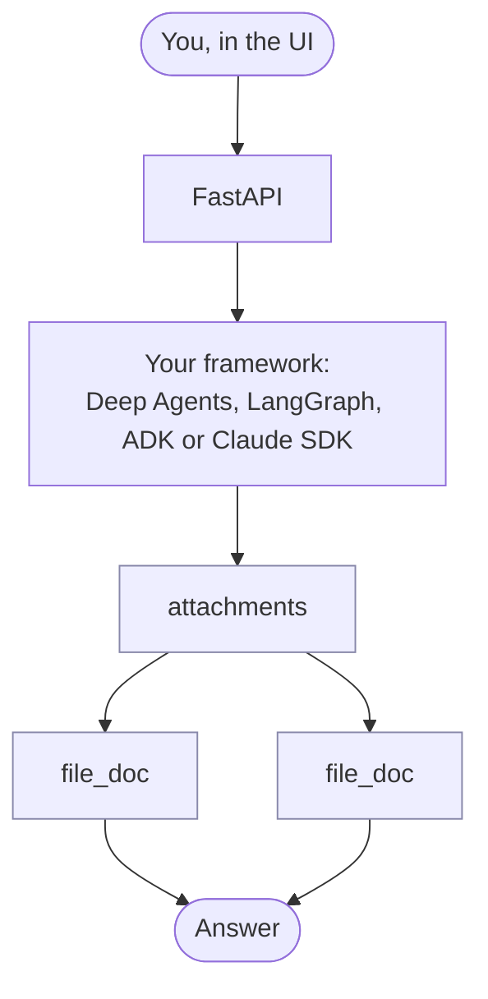

# 196. Save email attachments

**Area:** Documents, accounts and digital life  
**Features:** parallel calls, uses preferences

Moves attachments into the right folder.

## What you ask

> Save all the school PDFs from email to the Maya folder.

## Flow



## Tools

| Tool | Effect | Control |
|---|---|---|
| `attachments`: Email attachments by sender. | read-only | - |
| `file_doc`: Save to a folder. | changes your data | - |

## Preferences it uses

| Preference | Default |
|---|---|
| `kid` | Maya |

## Run it

```bash
python usecases/196_email_attachments_to_drive/usecase.py                 # your preferred framework
python usecases/196_email_attachments_to_drive/usecase.py --all           # all four frameworks
python usecases/196_email_attachments_to_drive/usecase.py --manual        # answer the approvals yourself
python usecases/196_email_attachments_to_drive/usecase.py --framework adk --live   # Gemini decides (needs GOOGLE_API_KEY)
```

Or start the app (`uvicorn app.api:app`), open http://localhost:8000 and pick it from the list.
