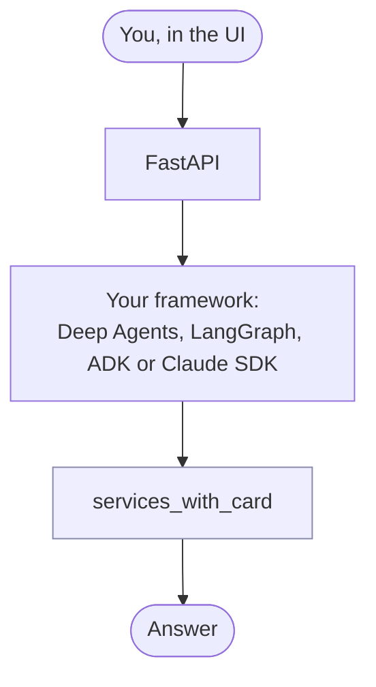

# 197. Update a card on file

**Area:** Documents, accounts and digital life  
**Features:** tools only

Lists services with the old card on file. You update them yourself; card details never go through the agent.

## What you ask

> My card was replaced. Which services have the old one?

## Flow



## Tools

| Tool | Effect | Control |
|---|---|---|
| `services_with_card`: Services charging a card. | read-only | - |

## Run it

```bash
python usecases/197_subscription_password_update/usecase.py                 # your preferred framework
python usecases/197_subscription_password_update/usecase.py --all           # all four frameworks
python usecases/197_subscription_password_update/usecase.py --manual        # answer the approvals yourself
python usecases/197_subscription_password_update/usecase.py --framework adk --live   # Gemini decides (needs GOOGLE_API_KEY)
```

Or start the app (`uvicorn app.api:app`), open http://localhost:8000 and pick it from the list.
