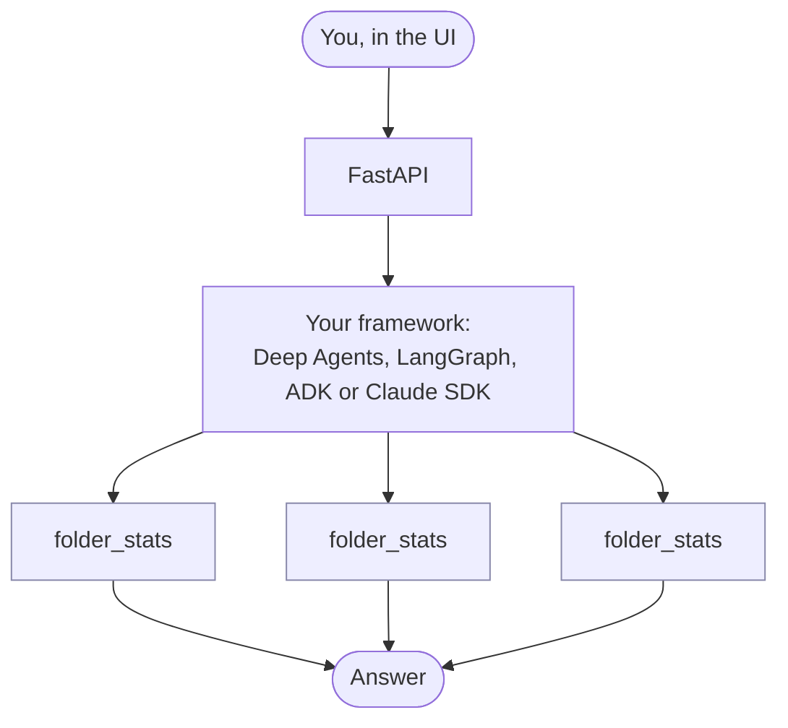

# 198. Monthly digital declutter

**Area:** Documents, accounts and digital life  
**Features:** parallel calls

Checks downloads, the desktop and old screenshots in parallel. Report only.

## What you ask

> Do my monthly digital declutter.

## Flow



## Tools

| Tool | Effect | Control |
|---|---|---|
| `folder_stats`: Folder size and file count. | read-only | - |

## Run it

```bash
python usecases/198_digital_declutter/usecase.py                 # your preferred framework
python usecases/198_digital_declutter/usecase.py --all           # all four frameworks
python usecases/198_digital_declutter/usecase.py --manual        # answer the approvals yourself
python usecases/198_digital_declutter/usecase.py --framework adk --live   # Gemini decides (needs GOOGLE_API_KEY)
```

Or start the app (`uvicorn app.api:app`), open http://localhost:8000 and pick it from the list.
