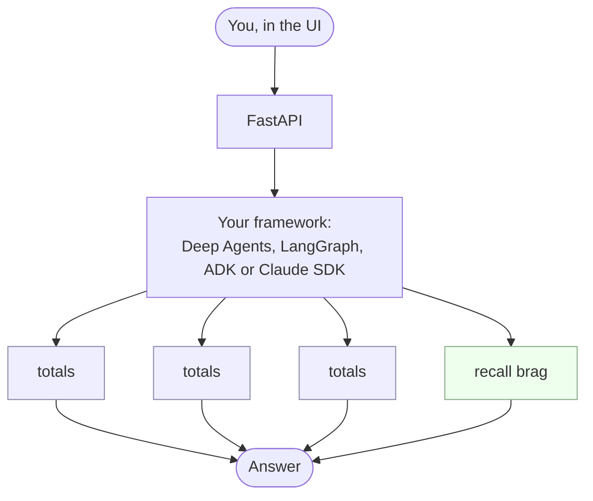

# 200. My year in review

**Area:** Documents, accounts and digital life  
**Features:** parallel calls, memory

Pulls from money, fitness, learning and memory for one look back at the year.

## What you ask

> Give me my year in review.

## Flow



## Tools

| Tool | Effect | Control |
|---|---|---|
| `totals`: Yearly totals. | read-only | - |

## Run it

```bash
python usecases/200_year_in_review/usecase.py                 # your preferred framework
python usecases/200_year_in_review/usecase.py --all           # all four frameworks
python usecases/200_year_in_review/usecase.py --manual        # answer the approvals yourself
python usecases/200_year_in_review/usecase.py --framework adk --live   # Gemini decides (needs GOOGLE_API_KEY)
```

Or start the app (`uvicorn app.api:app`), open http://localhost:8000 and pick it from the list.
