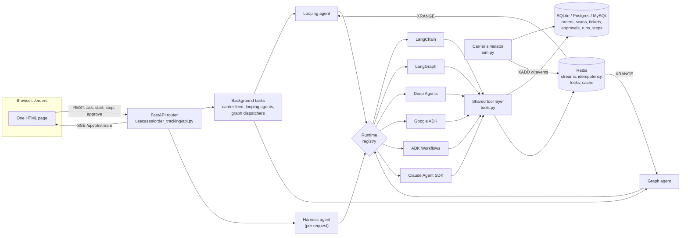
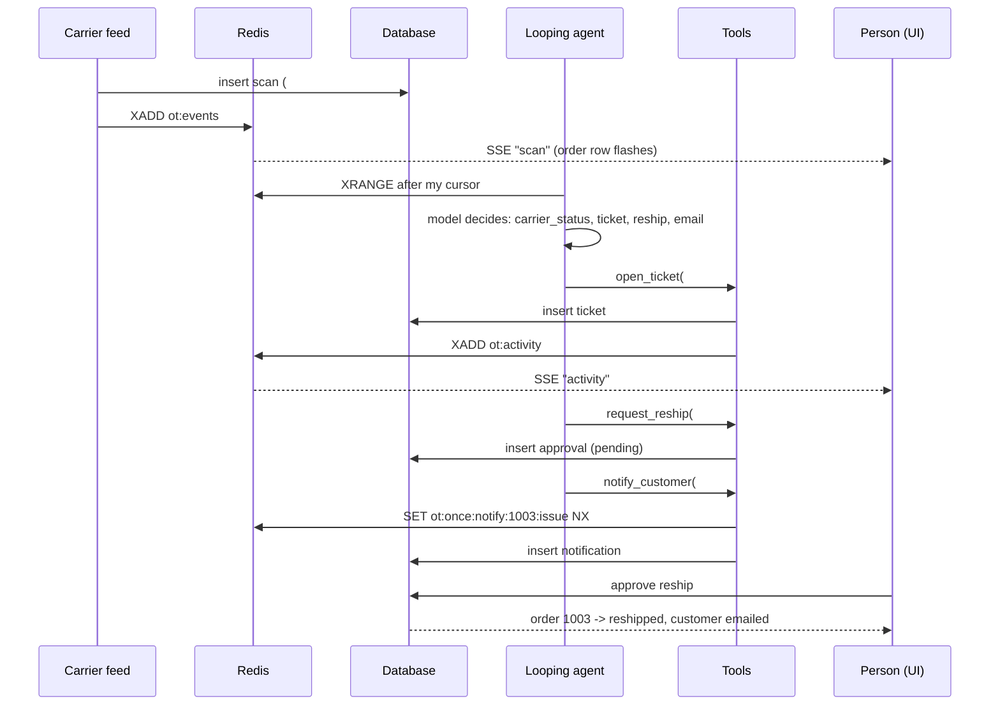
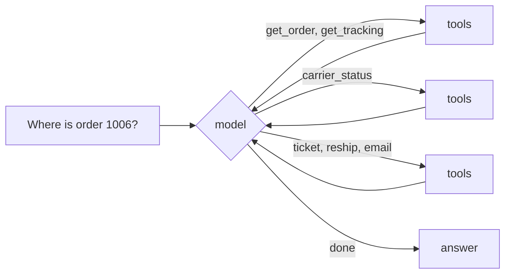
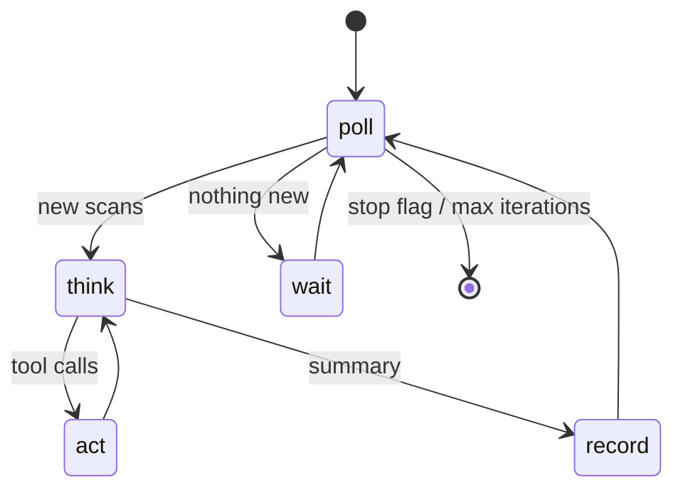
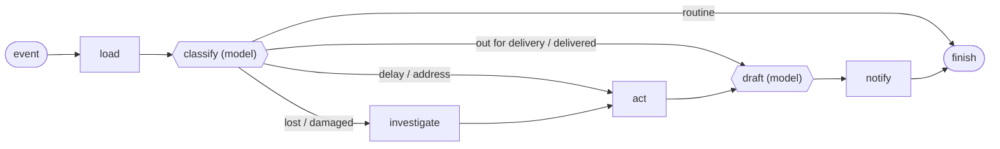
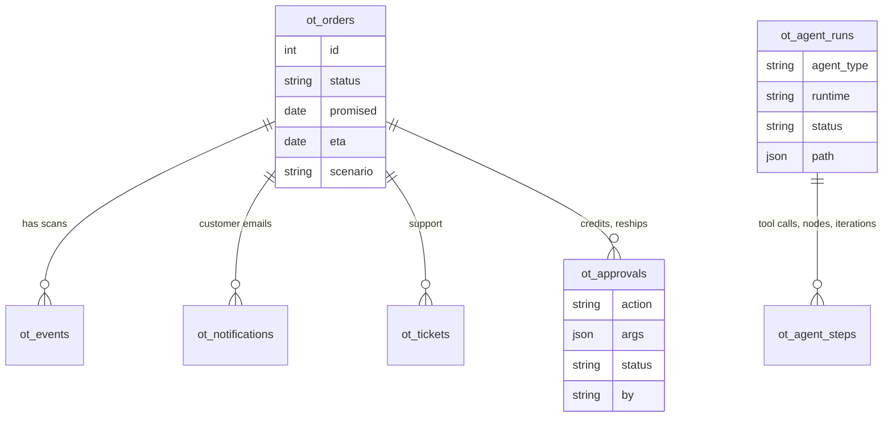

# Live order tracking: three kinds of agent, six runtimes

A store has 12 orders on their way to customers. A carrier feed sends scans as parcels move, and
some go wrong: a missed connection, a winter storm, a missing apartment number, a lost box, a
broken lamp. Agents watch, decide and act. They email customers, open tickets, and ask a person to
approve credits and replacements. It all happens live in the browser.

The point of this project is to compare **three kinds of agent** on the same live problem:

| | Harness agent | Looping agent | Graph agent |
|---|---|---|---|
| Starts when | A person asks something | It's started once and keeps running | A carrier event needs handling |
| Who decides what happens next | The model, turn by turn | The model, once per batch of events | Code: the graph's edges. The model only fills in judgment (classify, draft) |
| Good for | Open questions and investigations: "Where is order 1006?", "What's wrong with my orders?" | Watching a stream and reacting to whatever arrives | Repeatable, auditable handling of known situations |
| Cost and latency | Varies with the question | One model call per batch, scales with traffic | Fixed and predictable; two small model calls per event |
| What can go wrong | Wanders, or does too much | Falls behind, or acts twice on the same event | Can't handle what you didn't draw |

Each type runs on **six runtimes**: LangChain, LangGraph, LangChain Deep Agents, Google ADK,
Google ADK Workflows and the Claude Agent SDK. That's 18 implementations, and they all reach exactly
the same end state on the same day of events, which the tests check.

It uses the same stack as the rest of agent_app: one HTML page, then FastAPI, then the agents, then
SQLite, Postgres or MySQL plus Redis. The page is at `/orders` on the same server.

## Run it

```bash
cd agent_app
pip install -r requirements.txt
uvicorn app.api:app --reload          # then open http://localhost:8000/orders
```

In the page:

1. Pick a runtime at the top (LangGraph, say).
2. **Looping agent** tab, then **Start**. The agent is now watching.
3. **Start carrier feed**. Scans arrive every 2 seconds. Order statuses flash as they change, and the
   right-hand feed shows every scan and every tool call as it happens.
4. Optionally, switch to another runtime, open the **Graph agent** tab and press **Auto-run**. Now two
   agents on two different runtimes share the same stream; see "Two agents, one stream" below.
5. **Harness agent** tab: click an order or type "Which orders have problems?".
6. Approve or reject the credits and reships that pile up under **Waiting for you**.

With Postgres and Redis: `docker compose up --build` from `agent_app/`.

Without a browser:

```bash
python usecases/order_tracking/run_demo.py                                   # looping agent on LangGraph, scans printed live
python usecases/order_tracking/run_demo.py --agent graph --runtime adk_workflow
python usecases/order_tracking/run_demo.py --agent harness --runtime claude --ask "Where is order 1006?"
python usecases/order_tracking/run_demo.py --agent all                       # the 3 x 6 matrix
```

```
| agent   | LangChain | LangGraph | Deep Agents | Google ADK | ADK Workflows | Claude Agent SDK |
|---------|-----------|-----------|-------------|------------|---------------|------------------|
| harness | ok        | ok        | ok          | ok         | ok            | ok               |
| looping | ok        | ok        | ok          | ok         | ok            | ok               |
| graph   | ok        | ok        | ok          | ok         | ok            | ok               |

looping and graph agents end in the same state on every runtime: 27 emails, 4 tickets, approvals waiting: {'credit': 3, 'reship': 3}
```

## Architecture



There are three rules behind the layout:

1. **Redis is the nervous system, the database is the memory.**
   - Every scan is written to the `ot_events` table, for history, and to the `ot:events` Redis
     stream, for anyone listening.
   - Every agent action goes to `ot_agent_steps`, and also to the `ot:activity` stream. The browser
     reads both streams through Server-Sent Events.
2. **Agents only touch the world through the shared tool layer.** All 18 implementations call the
   same eight tools, so the safety rules (below) are written once.
3. **Runtimes are interchangeable modules.** `runtimes/<name>.py` each export
   `harness()`, `looping()` and `graph()`. `agents.py` adds the bookkeeping: run records, locks and
   stop flags.

## What happens when a scan arrives



## The three agent types

### Harness agent

Here, a "harness" is the scaffolding around a model that lets it work like an agent. It loops on
the model, runs tools, and often adds planning, sub-agents, files and context management. You give
it a goal and it decides the steps.



| Runtime | How the harness is built |
|---|---|
| LangChain | `create_agent(model, tools, middleware=[TodoListMiddleware()])`: a harness assembled from LangChain's parts |
| LangGraph | A hand-drawn ReAct graph: `agent <-> ToolNode`, with `tools_condition` as the edge. The minimal harness, nothing hidden |
| Deep Agents | `create_deep_agent(..., subagents=[carrier-investigator])`. For a lost or damaged parcel, the main agent hands the whole investigation to a sub-agent through the `task` tool, so it runs in its own context window |
| Google ADK | One `Agent` with tools; ADK's runner does the loop |
| ADK Workflows | `intake -> assistant -> audit`: fixed code around one open-ended agent node. The audit node counts the tool calls for the record |
| Claude Agent SDK | `ClaudeSDKClient` with the tools as an in-process MCP server. Claude Code's own harness does the planning |

### Looping agent

An agent that runs forever: poll, think, act, record, wait, repeat. Here it reads the `ot:events`
Redis stream from its own cursor, so a restart resumes where it left off. Each batch of new scans goes
to the model as one task.



| Runtime | How the loop is built |
|---|---|
| LangChain | A plain Python `while` loop around `create_agent`, with a fresh context per batch |
| LangGraph | **The loop is the graph.** Nodes `poll -> agent <-> tools -> record -> poll` and `poll -> wait -> poll` form one long-running invocation. `RemoveMessage(REMOVE_ALL_MESSAGES)` clears the previous batch's messages at each poll |
| Deep Agents | One deep agent on one checkpointed thread for the whole watch, so it remembers earlier iterations; Deep Agents' summarization keeps that bounded |
| Google ADK | One `Runner` and one session for the whole watch; a Python loop feeds each batch into the same session |
| ADK Workflows | **A workflow with a back edge**: `(poll, {"events": think, "idle": wait, "stop": done})`, `(think, record, poll)`, `(wait, poll)`. ADK 2.x workflows allow cycles; `ctx.route` picks the edge |
| Claude Agent SDK | One long-lived `ClaudeSDKClient`. Each batch is the next `query()` in the same conversation |

The loop is stopped by a Redis flag (`ot:flag:stop:looping:<runtime>`), so any process can stop it.
It finishes the current batch first.

### Graph agent

A fixed workflow per event. Code owns the path; the model is called only where judgment is needed:
classifying the event and drafting the email. Every run records the path it took, and the UI shows it
as chips.



| Runtime | How the graph is built |
|---|---|
| LangChain | LCEL: `load | classify | RunnableBranch(...)`, with `RunnableLambda` nodes |
| LangGraph | `StateGraph` with the nodes above, `add_conditional_edges` after classify, and a `path` list merged with `operator.add` |
| Deep Agents | The LangGraph graph, except lost/damaged parcels route to a **deep-agent node** that investigates and acts on its own. Deterministic where it can be, agentic where it must be |
| Google ADK | **An agent tree.** A `dispatcher` agent reads the event and calls `transfer_to_agent` to one of four specialists (delay, address, loss, notify). Here the graph is the agent hierarchy and the model picks the edge, which is the classic ADK multi-agent style |
| ADK Workflows | `Workflow(edges=[...])`. Function nodes do the work, `Agent(mode="single_turn")` nodes classify and draft, and `ctx.route` branches. This is the closest match to the diagram |
| Claude Agent SDK | The graph is plain Python. Claude is called with no tools at the judgment nodes, and as a full agent with tools at the investigate node |

A per-order Redis lock (`ot:lock:order:<id>`) stops two graph runs from working on the same order at
once.

## Keeping always-on agents safe

Looping and graph agents run unattended, so nothing they do may wait on a person or be dangerous if
done twice.

| Risk | What stops it | Where |
|---|---|---|
| An agent pays out money | `request_credit` / `request_reship` don't execute. They create an **approval** that a person decides in the UI. The agent never blocks; it records the request and moves on | `tools.py` |
| Too big a credit | A guard in code: at most $25, and at most 20% of the order | `tools._credit` |
| Reshipping something that wasn't lost | A guard: reships only for `lost` or `damaged` orders | `tools._reship` |
| Two emails for the same thing | `SET ot:once:notify:<order>:<kind> NX`: the second call returns "skipped" | `bus.once` |
| Two tickets for one problem | One open ticket per order | `tools._ticket` |
| Two agents on one order at once | `SET ot:lock:order:<id> NX EX 30` around each graph run | `agents.run_graph` |
| A restarted watcher re-reading old scans | A per-agent stream cursor in Redis | `LoopIO.poll` |
| A slow carrier API | 60-second Redis cache on `carrier_status` | `bus.carrier_cache_*` |

This is a different approval style from the rest of agent_app. There, a run **pauses** inside the
framework (interrupts, ADK confirmations, `can_use_tool`) until a person answers. That's right when
someone is waiting on the answer. Agents that run all day shouldn't stop, so here the approval is a
**queue**. Both are useful, and the app has both.

### Two agents, one stream

`test_looping_and_graph_agents_together_share_the_work` runs two agents at the same time, on the same
live feed:
- a LangGraph looping agent;
- an ADK Workflows graph dispatcher.

Each scan gets handled by whichever agent reaches it first. The customers still get exactly the 27
emails they should, with no duplicates, and the same tickets and approvals as with one agent. I saw the same in the
browser run: the looping agent sent 23 emails and the graph agent 4.

## Redis keys

| Key | Type | Purpose |
|---|---|---|
| `ot:events` | stream | Carrier scans (capped at 5,000) |
| `ot:activity` | stream | Agent steps, run starts and ends, approvals; feeds the browser |
| `ot:cursor:<who>` | string | Last stream id each always-on agent has read |
| `ot:once:<key>` | string, NX + TTL | Idempotency for emails |
| `ot:lock:order:<id>` | string, NX + EX | One graph run per order at a time |
| `ot:carrier:<id>` | string, EX 60 | Carrier API cache |
| `ot:flag:stop:<who>` | string | Stop switches for background loops |

## Tables



They share SQLAlchemy's `Base` and `DATABASE_URL` with the rest of agent_app.

## Offline and live

Offline, each runtime gets a stand-in model (`standins.py`). It asks one small rule-based policy,
`brain.decide(task, observations)`, what to do next:

| Stand-in | Used by |
|---|---|
| `PolicyChatModel`, a LangChain `BaseChatModel` | LangChain, LangGraph, Deep Agents |
| `PolicyLlm`, an ADK `BaseLlm` | ADK agents and workflow agent nodes |
| `PolicyCLI`, a Claude Agent SDK `Transport` | Claude; it plays the `claude` CLI's side of the stream-json protocol, including the MCP handshake and `tools/call` |

The stand-ins rebuild "what's the task, and what have the tools returned so far" from their
framework's own message format. That means a different event really does lead to different calls.
Everything else is real: the frameworks, the tools, the database and Redis.

Live mode sends the same `TASK: {...}` text to a real model, with the instructions in
`brain.SYSTEM`. Pick **live model** in the header and set the keys:

| Runtimes | Model setting | Key |
|---|---|---|
| LangChain / LangGraph / Deep Agents | `LC_MODEL` (for example `anthropic:claude-sonnet-5-5`, needs `langchain-anthropic`) | the provider's key |
| ADK / ADK Workflows | `ADK_MODEL`. Gemini by name; `provider/model` goes through LiteLLM | `GOOGLE_API_KEY` or the provider's key |
| Claude Agent SDK | `CLAUDE_MODEL` | `ANTHROPIC_API_KEY` |

The guards and idempotency don't change in live mode. They're code, so a model having a bad day
still can't send two emails or approve its own credit.

## API

Everything is under the same FastAPI app; the routes are in `api.py`.

| Method | Path | |
|---|---|---|
| GET | `/orders` | The live page |
| GET | `/api/ot/meta` | Runtimes, database engine, Redis kind |
| GET | `/api/ot/state` | Orders, approvals, tickets, emails, recent runs, what's running |
| GET | `/api/ot/events?limit=` | Recent scans, marked if they need action |
| GET | `/api/ot/stream?since=now\|start` | Server-Sent Events: `scan` and `activity` |
| POST | `/api/ot/reset?seed=` | New day: stops background work, re-seeds orders |
| POST | `/api/ot/sim/tick`, `/sim/start`, `/sim/stop` | Drive the carrier feed |
| POST | `/api/ot/harness` | `{runtime, ask, mode}`; returns the answer and every step |
| POST | `/api/ot/looping/start`, `/looping/stop?runtime=` | Background looping agent, one per runtime |
| POST | `/api/ot/graph/run` | `{runtime, event_id, mode}`; returns the summary and the path taken |
| POST | `/api/ot/graph/auto/start`, `/graph/auto/stop?runtime=` | Background graph dispatcher |
| POST | `/api/ot/approvals/{id}` | `{approve: true/false}` |
| GET | `/api/ot/runs/{id}` | A run with all its steps |

## Tests

`tests/test_order_tracking.py`, 23 tests:

- **18 combinations.** Each of the 3 agent types on each of the 6 runtimes replays the same day of
  events. The looping and graph agents must end with exactly the expected 27 emails, the 4 tickets
  (1003, 1004, 1006, 1011) and the 6 approvals (3 credits, 3 reships), with no duplicates. The
  harness must answer and fix the lost parcel.
- **Two agents together** on one stream, as described above.
- **Guards and approvals:**
  - a $100 credit is blocked;
  - a reship of a delivered order is blocked;
  - a second reship request for the same order returns the existing one;
  - an approval can only be decided once.
- **The API end to end:**
  - the graph run's path is checked node by node;
  - the Claude harness answers over HTTP;
  - approvals work over HTTP;
  - the SSE stream returns `scan` and `activity` events;
  - a background looping agent starts, is refused a second copy, and stops through the Redis flag.

Where it's been run:

| Setup | Result |
|---|---|
| SQLite + in-process Redis | 842 tests, the whole agent_app suite |
| Postgres 16 + Redis 7 | 842 tests |
| MariaDB 10.11 (MySQL driver) + Redis 7 | the 23 order-tracking tests |

I also clicked through the page in headless Chrome against Postgres and Redis. That run had a
LangGraph looping agent and an ADK Workflows graph dispatcher live at the same time, then a Claude
harness question, an approval, and a Deep Agents graph run. There were no browser errors and no server
errors.

## Going to production

- **Run the always-on agents as their own workers**, not inside the web process. To scale out,
  replace the per-agent cursor with a Redis consumer group (`XREADGROUP` / `XACK`): several workers
  can then share one stream, and a crashed worker's pending messages get claimed by another.
- **Replace the simulator with carrier webhooks.** The webhook handler does what `Simulator.tick`
  does: insert the scan and `XADD` it.
- **Filter before you pay.** Most scans (label created, picked up, in transit) need nothing. The
  looping agent already gets them in batches. A cheap pre-filter in `LoopIO.poll` that drops routine
  scans would cut model calls a lot.
- **Persist agent state across restarts:**
  - `PostgresSaver` for the Deep Agents looping thread;
  - `DatabaseSessionService` for ADK sessions;
  - Claude's session resume for the Claude loop.
- **Use real email and ticketing.** Keep the idempotency key in front of the real call.
- **Add auth to the approval endpoint**, and record who approved what (`decided_by` is already there).
- **Watch the loop.** Alert if `ot:events` grows faster than the cursors move.

## Files

```
usecases/order_tracking/
  README.md        this file
  api.py           FastAPI router (mounted in app/api.py) + SSE + background tasks
  ui.html          the /orders page
  agents.py        the three agent types: run_harness, run_looping, run_graph, graph_dispatcher
  runtimes/
    lc.py  lg.py  da.py  adk.py  adkwf.py  claude.py     one per runtime: harness(), looping(), graph()
    common.py      tool adapters per framework, model choice, LoopIO, shared graph nodes
  tools.py         the 8 tools, approvals, guards, run and step recording, snapshot for the UI
  brain.py         rules, prompts, and the stand-in policy
  standins.py      PolicyChatModel, PolicyLlm, PolicyCLI
  sim.py           the carrier simulator
  bus.py           Redis: streams, cursors, idempotency, locks, cache, flags
  models.py        ot_* tables
  run_demo.py      terminal demo
```
