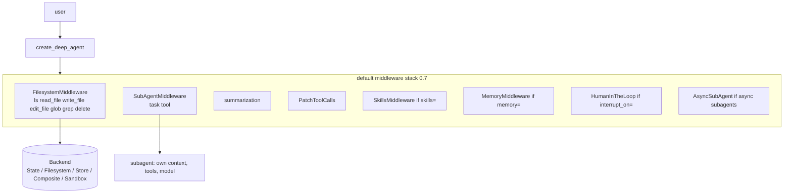

# LangChain Deep Agents deep dive

Checked against `deepagents 0.7.42` (Nov 2026). Requires Python 3.11+.

## What it is

An opinionated agent **harness** you can import: `create_deep_agent(...)` returns a LangGraph graph built from `create_agent` plus a middleware stack that gives the agent a filesystem, subagents, summarization and more. LangChain describes it as the same building blocks as `create_agent`, with filesystem, sub-agents, context management and skills bundled in. Model-agnostic.

## Version notes that trip people up

* **0.7 removed the `write_todos` planner from the default harness.** Older tutorials, and the first version of this repo's `s19` notes, say it's built in. Add it back with `middleware=[TodoListMiddleware()]` (`05_todos_and_custom_middleware.py`).
* **0.7 gives agents a recursive delete tool** whenever the backend supports it, and permissions treat delete as a write. A rule allowing writes to a path now also allows deleting it. Review your `permissions=`.
* **0.5 added async subagents**: they return a task ID immediately, run on a remote server and keep their own thread, so the supervisor can follow up. They need a LangSmith Deployment.
* **0.6 added a typed streaming primitive** for messages, tool calls and subagents, from the runtime to the frontend.
* Subagent dict keys: `name`, `description`, `system_prompt`, `tools`, optional `model`, `skills`, `permissions`, structured response format.

## Backends

| Backend | Files live in | Use for |
|---|---|---|
| `StateBackend()` (default) | graph state, per thread | scratch work |
| `FilesystemBackend(root_dir, virtual_mode=True)` | a real folder, paths sandboxed | repos, skills and AGENTS.md on disk |
| `StoreBackend(namespace=..., store=...)` | a LangGraph store | memory that survives threads |
| `CompositeBackend(default, routes={"/memories/": ...})` | mixed by path prefix | ephemeral scratch + persistent `/memories/` |
| `LocalShellBackend`, sandbox backends | adds an `execute` tool | running code |

## Examples

| File | Use case | Shows |
|---|---|---|
| `01_quickstart_subagents_filesystem.py` | Research overdue balances, keep notes | `task` subagent with its own model, `write_file`/`read_file` |
| `02_human_in_the_loop.py` | Send a reminder, refuse a purge | `interrupt_on`, reject with a reason the model reads |
| `03_backends_and_long_term_memory.py` | Remember a preference across conversations | `CompositeBackend` + `StoreBackend` under `/memories/` |
| `04_skills_and_agents_md.py` | Team skill + house rules shipped as files | `skills=["/skills/"]`, `memory=["/AGENTS.md"]`, progressive disclosure (the test prints what is and isn't in the prompt) |
| `05_todos_and_custom_middleware.py` | Month-end close | `TodoListMiddleware` back in, custom `@wrap_tool_call` audit trail |

## Deep Agents vs Claude Agent SDK

| | Deep Agents | Claude Agent SDK |
|---|---|---|
| Models | any LangChain model | Claude |
| Filesystem | virtual by default, pluggable backends | real filesystem of the host/sandbox |
| Subagents | dicts, sync or async | `AgentDefinition` |
| Approvals | `interrupt_on` + checkpointer | `can_use_tool`, hooks |
| Runtime | LangGraph (checkpoints, streaming, time travel) | Claude Code runtime (sessions, compaction) |
