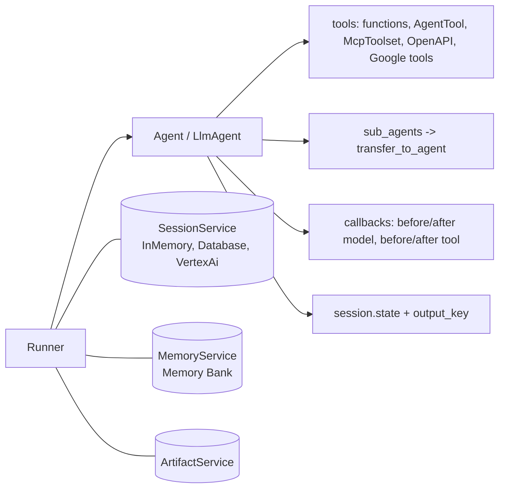

# Google ADK deep dive (agents, tools, callbacks, delegation)

Checked against `google-adk 2.15.1` (Nov 2026). For the new graph runtime see [../google_adk_workflows](../google_adk_workflows/README.md).

## ADK in one picture



* **Agent** (`from google.adk import Agent`, alias of `LlmAgent`): model + instruction + tools (+ sub_agents). The instruction can template state: `"Write using {history}"`.
* **Tools**: plain functions (docstring + type hints become the schema). Add a `tool_context: ToolContext` parameter to read or write state, set `actions.escalate`, and save artifacts.
* **Runner**: binds an agent (or, in 2.x, a Workflow `node=`) to services and yields Events from `run_async`.
* **Callbacks**: `before_model_callback` (return an `LlmResponse` to skip the model), `before_tool_callback` (return a dict to skip the tool), `after_tool_callback` (rewrite results), plus after-model and agent-level ones.
* **Delegation**: `sub_agents` (control transfers, LLM decides) vs `AgentTool` (call an agent like a function; caller stays in charge).
* **Deploy**: `adk web` / `adk run` / `adk api_server` locally, Cloud Run, or Vertex AI Agent Engine. Agent Engine adds Memory Bank and managed sessions.
* **Model-agnostic**: Gemini by default; other providers through the LiteLLM wrapper. Any `BaseLlm` subclass works, which is how these examples run offline.

## Examples

| File | Use case | Shows |
|---|---|---|
| `01_agent_tools_state.py` | Finance agent | function tools, `ToolContext.state`, `output_key` |
| `02_callbacks_guardrails.py` | Collections agent with guardrails | block card numbers before the model, approve sends, mask emails in tool output |
| `03_multi_agent_transfer.py` | Help desk | coordinator + `sub_agents`, automatic `transfer_to_agent` |
| `04_classic_workflow_agents.py` | Research -> draft -> review loop | `ParallelAgent`, `SequentialAgent`, `LoopAgent` + `escalate`; **deprecated in 2.x** |
| `05_agent_as_tool_and_mcp.py` | Orchestrator using a summarizer | `AgentTool`; `McpToolset` snippet |

## Running

```bash
pip install -r requirements-adk.txt          # google-adk (Python 3.10+; 3.11+ recommended for 2.x)
python frameworks/google_adk/01_agent_tools_state.py               # offline
GOOGLE_API_KEY=... python frameworks/google_adk/01_agent_tools_state.py --live
```

MCP support is optional in 2.x: `pip install mcp` (or `google-adk[extensions]`). `McpToolset` is only exported when `mcp` is installed.
