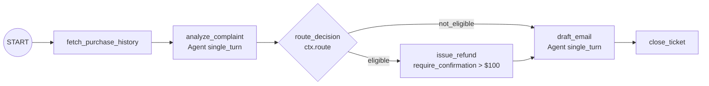

# Google ADK 2.0 Workflows deep dive (and what's new in ADK 2.x)

Checked against `google-adk 2.15.1` (Nov 2026).

## What changed in ADK 2.0

ADK 2.0 went GA for Python on May 19 2026, Go on June 30 and TypeScript on August 21. The headline is the **Workflow Runtime**: ADK moved from a hierarchical agent executor to a **graph-based execution engine**. Agents, tools and functions are all nodes in that graph.

| Change | 1.x | 2.x |
|---|---|---|
| Orchestration | LLM-driven delegation + Sequential/Parallel/Loop agents | `Workflow` graphs: edges, routing, fan-out/join, loops, retries, dynamic nodes, HITL |
| What an agent is | standalone executor | `BaseAgent` subclasses `BaseNode`; agents are nodes |
| Runner | `Runner(agent=...)` | `Runner(agent=...)` or `Runner(node=workflow)` |
| Events | content + actions | new `node_info` and `output` fields to track graph state and workflow outputs |
| Agent modes | chat only | `mode="chat"`, `"single_turn"`, `"task"` (Task API: structured agent-to-agent delegation, multi-turn task mode, HITL, task agents as workflow nodes) |
| Human-in-the-loop | tool confirmation | any node can pause the graph (`RequestInput`) and durably wait; `@node(require_confirmation=...)` |
| Imports | `google.adk.agents` | also top-level `from google.adk import Agent, Workflow, Runner, Context, Event` |
| Classic workflow agents | the way to do deterministic flows | **deprecated**: "deprecated in favor of Workflow and will be removed in a future version. Workflow cannot yet be used as an LlmAgent sub-agent." |
| Sessions | | written by 2.0, readable by 1.28+; older 1.x can't read them |
| Python | 3.9+ | 3.11+ for the 2.0 betas; current releases 3.10+ |

To stay on 1.x: `pip install "google-adk~=1.0"`.

Since 2.0 (bi-weekly cadence, 2.15 as of late Nov): GenAI SDK v2 support (the interactions helpers moved from "turns" to "steps" terminology in 2.2), A2A per-invocation auth headers and persistent task stores, `adk deploy agent_engine --extra_packages`, fallback models, a LiveKit voice runtime, and graphs defined in YAML (2.9).

## Why graphs

Google's own argument, from "Why we built ADK 2.0":

* **Programmatic routing**: the next step is chosen in code, not by an LLM reading raw tool output.
* **Strict state boundaries**: each node gets only the data it needs, so less context bloat.
* **Security**: a manipulated LLM node can't trigger an action that has no edge.
* **Efficiency**: in Google's illustrative benchmark (gemini-3.5-flash, mock APIs), the workflow used about 50% fewer tokens and 20% less latency than a single agent.

Autonomous agents are still supported. The recommended shape is deterministic nodes for routing and side effects, and single-turn agents only where language reasoning is needed.

## The API in five lines

```python
from google.adk import Agent, Context, Workflow
from google.adk.workflow import START, JoinNode, node, RetryConfig

def classify(ctx: Context, node_input):        # any function is a node
    ctx.route = "firm" if node_input["days"] > 7 else "nudge"
    return node_input

wf = Workflow(name="ladder", edges=[
    (START, lookup, classify),                 # chain
    (classify, {"firm": firm, "nudge": nudge}),# route on ctx.route
])
```

| Edge form | Meaning |
|---|---|
| `(START, a, b, c)` | chain |
| `(a, {"x": b, "y": c})` | route on `ctx.route` (strings, bools...) |
| `(START, (a, b))` | fan-out, parallel |
| `((a, b), JoinNode(name="j"))` | fan-in; output is `{"a": ..., "b": ...}` |
| `@node(retry_config=RetryConfig(...), timeout=...)` | resilience per node |
| `@node(rerun_on_resume=True)` + `await ctx.run_node(n, node_input=...)` | dynamic nodes; Python loops become workflow steps |
| `return RequestInput(interrupt_id=..., message=...)` | pause for a human; resume with a FunctionResponse carrying that id |
| `@node(require_confirmation=True or predicate)` | approve/reject before the node runs |
| `Agent(mode="single_turn")` as a node | one LLM call, back to the graph |



## Examples

| File | Use case | Shows |
|---|---|---|
| `01_graph_routing.py` | Escalation ladder | chain + dict routing, `ctx.state`, no model |
| `02_fanout_join.py` | Pre-call briefing from three sources | parallel fan-out, `JoinNode` (three 50 ms lookups finish in ~60 ms) |
| `03_human_in_the_loop.py` | Approve or edit an outgoing reminder | `RequestInput` pause, resume via FunctionResponse, `ctx.resume_inputs` |
| `04_dynamic_nodes_retry_timeout.py` | Flaky payment API + iterative shortening | `RetryConfig`, `ctx.run_node` in a while loop, `timeout` |
| `05_agent_nodes_single_turn.py` | Support inbox triage | LLM classifies, code routes |
| `06_require_confirmation.py` | Pay vendor bills | `require_confirmation` predicate (only over $500) |
| `07_usecase_refund_workflow.py` | End-to-end refund (Google's blog shape, extended) | everything together; prompt-injected "$10,000" can't change the amount |

## Gotchas found while building these

* A node that calls `ctx.run_node` must be `@node(rerun_on_resume=True)`, or ADK raises a clear `ValueError` telling you so.
* The first node receives the user's `types.Content`; read text from `node_input.parts[0].text`.
* `RetryConfig` retries locally; the retry count isn't persisted across a resume.
* Classic `SequentialAgent`/`ParallelAgent`/`LoopAgent` still run but warn. Keep them only where you need a workflow nested under an `LlmAgent`.
* The HITL function-call name is `adk_request_input`; confirmation ids look like `wf_tool_confirmation:<workflow>@1/<node>@1`.
