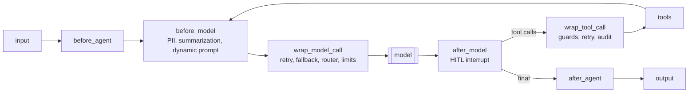

# LangChain 1.x deep dive

Checked against `langchain 1.5.2`, `langchain-core 1.8.5`, `langgraph 1.2.24` (Nov 2026).

## What changed in 1.x, and why it matters

LangChain 1.0 shrank the library around one thing: **the agent loop**.

* **`create_agent`** is the standard way to build an agent. It replaced `langgraph.prebuilt.create_react_agent`, which is deprecated. It returns a compiled LangGraph graph, so persistence, streaming, interrupts and time travel come for free.
* **Middleware** is the new extension point. Instead of subclassing agents, you stack small hooks that run before/after the model call, around each tool call, or around the whole run.
* **Standard content blocks** (`message.content_blocks`) give one shape for reasoning, citations, images and tool calls across providers.
* The old chains, retrievers and agents moved to `langchain-classic`.
* Since 1.0: `SystemMessage` accepted as `system_prompt` (cache control), model retry middleware, `stream_events(version="v3")` (1.3), MCP support built in (1.4).



## The middleware catalogue (in `langchain.agents.middleware`)

| Middleware | What it's for |
|---|---|
| `HumanInTheLoopMiddleware(interrupt_on={...})` | Pause before chosen tools; resume with approve / edit / reject |
| `PIIMiddleware("email", strategy="redact"/"mask"/"hash"/"block")` | Strip PII from input/output before the model sees it |
| `SummarizationMiddleware` | Summarize old turns when the context grows |
| `ContextEditingMiddleware` | Clear old tool results to save tokens |
| `ModelCallLimitMiddleware`, `ToolCallLimitMiddleware` | Cost and loop guards per run or thread |
| `ModelRetryMiddleware`, `ToolRetryMiddleware`, `ModelFallbackMiddleware` | Resilience |
| `ModelRouterMiddleware`, `LLMToolSelectorMiddleware` | Pick a model or narrow the toolset per request |
| `TodoListMiddleware` | Adds a `write_todos` planning tool |
| `ShellToolMiddleware`, `FilesystemFileSearchMiddleware` | Shell and file search with execution policies (host, Docker, Codex sandbox) |
| Decorators: `@before_model`, `@after_model`, `@wrap_model_call`, `@wrap_tool_call`, `@dynamic_prompt`, `@before_agent`, `@after_agent` | Write your own in a few lines |

## Examples

| File | Use case | Shows |
|---|---|---|
| `01_create_agent_basics.py` | AR assistant | tools, system prompt, the graph underneath |
| `02_middleware_guardrails.py` | Collections agent that must not email the wrong person | PII redaction, dynamic prompt, custom egress guard, call limits, HITL edit/approve |
| `03_structured_output.py` | Inbox triage into a typed ticket | `response_format=ToolStrategy(PydanticModel)` |
| `04_memory_threads_and_store.py` | Remember customer preferences across conversations | checkpointer threads (short-term) + store via `ToolRuntime` (long-term), typed context |
| `05_multi_agent_and_resilience.py` | Monday collections prep | agents as tools (supervisor), `ToolRetryMiddleware`, `ModelCallLimitMiddleware` |

One detail in `02` is worth seeing for yourself. The human *approves* the second email, and the deterministic `@wrap_tool_call` guard still blocks it, because the address isn't a customer domain. Human approval and code-level policy are separate layers, and you want both.

## Run

```bash
pip install -r requirements-langchain.txt
python frameworks/langchain/01_create_agent_basics.py                 # offline, scripted model
LC_MODEL=anthropic:claude-sonnet-4-6 python frameworks/langchain/01_create_agent_basics.py --live
```

`LC_MODEL` takes any `init_chat_model` string: `openai:gpt-4.1`, `google_genai:gemini-2.5-flash`, `anthropic:claude-sonnet-4-6`, `ollama:llama3.1`, ...

## MCP tools (live)

```python
from langchain_mcp_adapters.client import MultiServerMCPClient
client = MultiServerMCPClient({"stripe": {"transport": "streamable_http", "url": "https://.../mcp"}})
tools = await client.get_tools()
agent = create_agent("anthropic:claude-sonnet-4-6", tools=tools)
```
