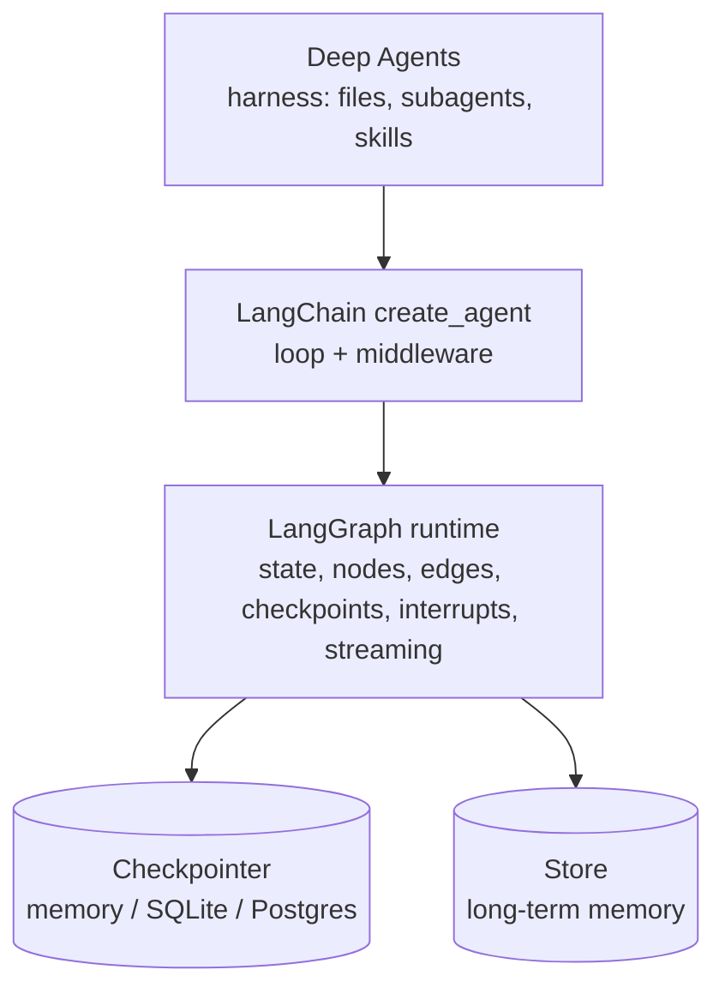

# LangGraph 1.x deep dive

Checked against `langgraph 1.2.24` (Nov 2026).

## Where LangGraph sits

LangChain's `create_agent` and Deep Agents both compile **to** LangGraph. Use LangGraph directly when you need control the prebuilt loop doesn't give you: fixed routes, fan-out, long waits for humans, replays.

## Core ideas

| Concept | API | Why |
|---|---|---|
| State | `TypedDict` / Pydantic; reducers via `Annotated[list, operator.add]` or `add_messages` | Nodes return partial updates; reducers merge parallel writes |
| Nodes and edges | `add_node`, `add_edge`, `add_conditional_edges` | Routes are Python, so they're testable |
| Fan-out | `Send(node, payload)` from a conditional edge | Map-reduce over N items in parallel |
| Handoffs | return `Command(goto=..., update=...)` | Multi-agent supervisor and swarm patterns |
| Human-in-the-loop | `interrupt(payload)` in a node; resume with `Command(resume=value)` | Durable pause; resume any time, from any process |
| Persistence | `compile(checkpointer=...)`, `thread_id` in config | Threads, resume after crashes, HITL |
| Time travel | `get_state_history`, `update_state`, `invoke(None, cfg)` | Debug and fork runs without redoing earlier steps |
| Functional API | `@entrypoint`, `@task` | Same runtime, normal Python control flow; tasks are checkpointed |
| Streaming | `stream_mode="updates"`, `"values"`, `"messages"`, `"custom"` (`get_stream_writer()`) | Live UIs and progress |
| Durability and timeouts | node timeouts, error recovery, graceful shutdown (recent 1.x releases) | Long-running production graphs |

## Examples

| File | Use case | Shows |
|---|---|---|
| `01_stategraph_routing.py` | Invoice escalation ladder | state, conditional edges, Mermaid export |
| `02_map_reduce_send.py` | Draft reminders for every overdue invoice at once | `Send` fan-out + `operator.add` reducer |
| `03_interrupt_human_in_the_loop.py` | Approve / edit / reject an outgoing email | `interrupt()` + `Command(resume=...)` + checkpointer |
| `04_supervisor_command_handoffs.py` | A Chief-of-Staff agent routing finance and comms | `Command(goto=...)` handoffs |
| `05_functional_api.py` | Nightly scoring job with an approval gate | `@entrypoint`, parallel `@task`s, interrupt; checkpointed task not re-run on resume |
| `06_time_travel_and_streaming.py` | "What if the tone had been firm?" | stream modes, state history, forking from a past checkpoint |

All of these run with no model at all, apart from `04`, which uses the scripted model for the supervisor's choices. That's deliberate: most of what makes an agent reliable is the graph around the model.

## LangGraph vs ADK 2.0 Workflows

They converged. Both now offer a graph runtime with code routing, fan-out/join, durable human-in-the-loop and resumable state.

| | LangGraph | ADK 2.0 Workflow |
|---|---|---|
| Graph definition | builder API (`add_node`/`add_edge`) or Functional API | list of edge tuples, `@node` |
| Routing | conditional edge function returns node name(s) | node sets `ctx.route`; dict edges |
| Fan-out | `Send` | tuple of nodes + `JoinNode` |
| HITL | `interrupt()` / `Command(resume=)` | `RequestInput` / FunctionResponse, `require_confirmation` |
| Dynamic work | `Send`, functional tasks | `ctx.run_node()` |
| Retries | `RetryPolicy` on nodes | `RetryConfig` on nodes |
| State | typed state + reducers | `ctx.state` (+ optional `state_schema`) |
| Ecosystem | model-agnostic, LangSmith | Gemini-first, Agent Engine, A2A |
