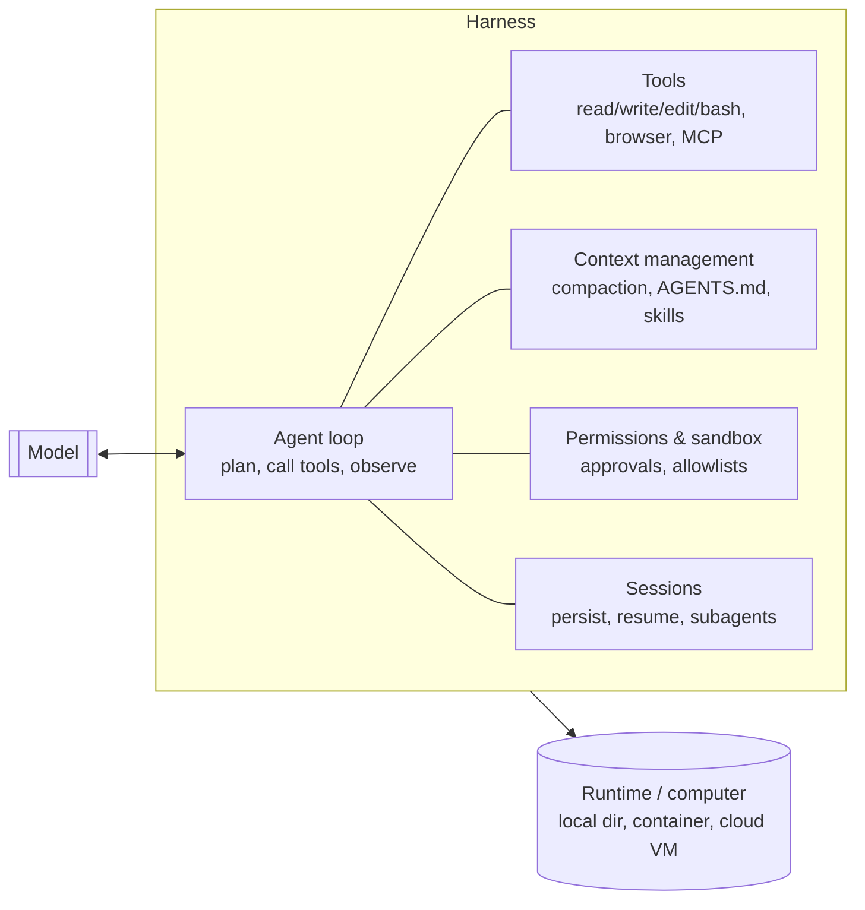

# Harness agents: what Manus, OpenClaw, Hermes, Genspark, Comet, Cursor, Devin and Codex run on

Plus the open-source harnesses worth knowing in late 2026, and runnable examples.

[Understand.md](../Understand.md) covered the four big personal agents. This section does the same for the "other platforms" list, and then the open-source field.

---

## 1. What a harness is, in one picture

The same model can score very differently in different harnesses. DataCamp's survey cites a Composio test where one model ranged from 46.7% to 66.7% depending on the harness, with the minimal Pi near the top. Perplexity reported the same kind of effect with its own harness on a fixed local model. That's why the companies now talk about their harness by name.

---

## 2. The eight platforms

| Platform | Harness | Open? | Where it runs | How you drive it from code | Example in this repo |
|---|---|---|---|---|---|
| **Manus** | **Cascade**, Manus's in-house harness (Manus 2.0, Sep 28 2026) | Closed | Manus cloud computer; optional dedicated Cloud Computer | REST v2 (`task.create` ...), OpenAI-compatible surface | `services/s11_manus` |
| **OpenClaw** | **Pi** (`pi-mono`: pi-ai, pi-agent-core, pi-coding-agent, pi-tui), embedded via its SDK, wrapped with a gateway | MIT | Your machine | Gateway HTTP (`/v1/responses`), CLI | `services/s08_openclaw`, `examples/pi_style_minimal_harness.py` |
| **Hermes Agent** | Its own Python harness with a closed learning loop (skills it writes itself), memory, cron, gateway | MIT | Your machine or managed | CLI / desktop; as a library by forking | `services/s12_hermes_agent` |
| **Genspark** | Mixture-of-agents engine across several frontier models | Closed | Genspark cloud | Remote MCP server (`/api/mcp`, OAuth 2.1) | `services/s13_genspark` |
| **Perplexity Comet / Computer** | Perplexity's multi-model orchestration harness (Computer), local harness in Personal/Portable Computer | Closed | Browser (Comet); cloud (Computer); your Mac/PC (Personal Computer) | Agent / Search / Sandbox APIs | `services/s10_...`, `services/s14_...` |
| **Cursor** | **Cursor SDK harness** (also powers Bugbot, Security Review, Grok Bot's runtime family) | Closed core, open bridge protocol | Local tree or Cursor cloud VM | `cursor-sdk` (Python), `@grok/agent-sdk`, Cloud Agents API | `services/s15_cursor` |
| **Devin** | Cognition's proprietary harness | Closed | Devin cloud machine | REST API v3 sessions | `services/s16_devin` |
| **Codex** | **Codex harness** ("Codex core", Rust), exposed through the app-server JSON-RPC protocol | Apache 2.0 | Local app-server; Codex cloud | `openai-codex` SDK, app-server | `services/s17_openai_codex` |

### 2.1 Manus: Cascade

Manus 2.0 introduced Cascade as "the latest iteration of our in-house agent harness". The idea is to start a project light and add specialized tools only when the context calls for them. Manus reported that in one tested configuration it used 23.2% fewer tokens, finished 28.2% faster and cost 32% less than the previous system. Around it: a dedicated Cloud Computer per project if you want one, event-triggered Automations (email, calendar, Slack, Notion), Manus Studio (the shared workspace that replaced the desktop app), and Cue for personal agents on the same infrastructure.

*From Python:* the v2 API (`task.create`, `task.detail`, `task.listMessages`, `task.sendMessage`). Cascade itself isn't exposed as a library.

### 2.2 OpenClaw: a gateway around Pi

OpenClaw's agent core is **Pi**, Mario Zechner's minimal coding agent. OpenClaw imports Pi's SDK directly (`createAgentSession()` from `pi-coding-agent`), replaces Pi's default bash/read/edit/write with sandbox-aware versions, adds its own tools (messaging, browser, canvas, sessions, cron, gateway), and builds the system prompt from workspace files, skills, channel context and memory.

Pi's philosophy, which is the interesting part:

* **four tools** (read, write, edit, bash) and a very short system prompt;
* **no built-in MCP**: the argument is that big MCP servers burn context (Playwright MCP was cited at about 13.7k tokens for 21 tools), so build small CLIs with READMEs the agent reads on demand;
* **no built-in subagents or plan mode**: users ask Pi to extend Pi.

`examples/pi_style_minimal_harness.py` reproduces that four-tool harness in Python and runs a real fix-the-failing-test loop.

### 2.3 Hermes Agent

Terminal-native, MIT licensed, model-agnostic (Nous Portal, OpenRouter, OpenAI, any endpoint). It differs from the others in its **closed learning loop**: after a task it writes or refines a SKILL.md, so later runs are shorter. Skills use the agentskills.io format and can come from hubs (ClawHub, LobeHub, others) with quarantine. It also has cron with delivery to chat platforms, subagents, and research hooks (trajectory export, RL environments). `services/s12_hermes_agent` shows the learning loop: 6 steps on the first run, 3 on the second.

### 2.4 Genspark

A no-code AI workspace (Slides, Sheets, Docs, "Call For Me", an AI browser, Genspark Claw) on a mixture-of-agents engine that routes across several models and cross-checks them. The developer surface is a hosted remote MCP server behind OAuth 2.1, so "using Genspark from Python" means being an MCP client (`services/s13_genspark`).

### 2.5 Perplexity: Comet and Computer

* **Comet** is the AI browser: an agent in the sidebar acting on the page you're on.
* **Computer** is the orchestration harness. It breaks a goal into tasks and subtasks and creates sub-agents for each, using different models for different jobs. At launch Opus 4.6 did the core reasoning, Gemini the deep research, and other models images and video. It was prototyped on Claude Code.
* **Personal Computer** (Mac, Windows) and **Portable Computer** (fully local on a DGX Spark) bring that harness onto your hardware. The design point Perplexity stresses is that deterministic software, not the model, holds authority. Approved actions run in an OS sandbox, and if the sandbox is unavailable, tools don't run.
* Retrieved content is screened for prompt injection (BrowseSafe), and sensitive actions need confirmation.

### 2.6 Cursor

One harness behind the editor agent, Bugbot, Security Review and the Agent SDK. Grok Bot lives on the same infrastructure. Python: `cursor-sdk` with `local=` or `cloud=` runtimes. See `services/s15_cursor` and Understand.md section 3.4.

### 2.7 Devin

Cognition's closed harness. A session is a cloud machine with a shell, editor and browser. The integration pattern that matters is that one HTTP call creates a session, so any other agent can hand work to Devin as a tool.

### 2.8 Codex

OpenAI's harness, open source under Apache 2.0, written in Rust. The agent loop lives in "Codex core" and is exposed through the **app-server**, a bidirectional JSON-RPC protocol. The web app, CLI, IDE extension and macOS app all drive it, and dots grew out of it. Python: `openai-codex`, with per-turn sandbox presets (`read_only`, `workspace_write`, `full_access`).

---

## 3. Open-source harnesses worth knowing (late 2026)

| Harness | Language | Licence | What makes it different | Drive it from Python |
|---|---|---|---|---|
| **OpenCode** (SST) | TypeScript | MIT | The most-starred open coding agent of 2026; provider-agnostic; runs LSP servers in the background so the agent has structured awareness of the code | subprocess: `opencode run "..."` |
| **Codex CLI** | Rust | Apache 2.0 | Open harness from a frontier lab; sandbox presets; subagents | `openai-codex` SDK |
| **Pi** (`pi-mono`) | TypeScript | MIT | Four tools, short prompt, self-extending; the engine in OpenClaw | subprocess / RPC mode |
| **OpenClaw** | TypeScript | MIT | Pi + a multi-channel gateway, routing, heartbeats, ClawHub skills | gateway HTTP |
| **Hermes Agent** | Python | MIT | Learns skills from experience; cron; gateway | CLI |
| **goose** | Rust | Apache 2.0 | Contributed by Block to the Linux Foundation's Agentic AI Foundation (with MCP and AGENTS.md); MCP extensions, YAML recipes, ACP so the runtime is separate from the UI | subprocess: `goose run ...` |
| **OpenHands** (Software Agent SDK) | Python | MIT | A real Python SDK: agent, tools and workspaces as packages; local, Docker or remote agent server; OpenAI-compatible endpoint | `openhands.sdk` (see `examples/openhands_sdk_example.py`) |
| **Aider** | Python | Apache 2.0 | The original terminal pair-programmer (2023); git-native, repo map | subprocess: `aider --message ...` |
| **Cline / Roo Code** | TypeScript | Apache 2.0 | VS Code agents with explicit approve-each-step UX | IDE |
| **Gemini CLI -> Antigravity CLI** | Go (rebuilt) | Apache 2.0 (Gemini CLI) | Google's terminal agent; now a surface of the Antigravity harness | subprocess |
| **SWE-agent** | Python | MIT | Research harness behind SWE-bench work; agent-computer interface design | Python |
| **Deep Agents** (LangChain) | Python / TS | MIT | Harness *kit*: filesystem backends, subagents, async subagents, skills, HITL on LangGraph | `deepagents` (see `frameworks/deep_agents`) |

### Picking one

* **Embed a coding agent in your own Python service:** OpenHands SDK, Codex SDK, Claude Agent SDK, or Deep Agents.
* **Personal, always-on agent on your own box:** OpenClaw or Hermes, in a VM or container.
* **Terminal coding with any model:** OpenCode or goose. Pi if you want to see every token that goes into the context.
* **Pipelines and CI:** any harness with a headless mode, wrapped as one step (`examples/drive_headless_harnesses.py`), or a framework node that calls it.

---

## 4. The five parts, compared

| | Loop | Tools | Context | Permissions | Sessions |
|---|---|---|---|---|---|
| Pi | minimal | 4 built-in, extend by writing code | tiny system prompt, compaction, skills | none by default; run it in a container | JSONL sessions |
| OpenClaw | Pi's | Pi's 4 replaced + messaging, browser, cron... | prompt built from workspace, skills, memory | gateway auth, DM allowlists, sandbox policy | per channel and peer |
| Codex | Codex core | shell, apply-patch, MCP | AGENTS.md, compaction, retained reasoning | sandbox presets + approval modes | threads |
| OpenHands | SDK agent | file editor, terminal, task tracker, MCP | microagents/skills | workspace isolation (Docker/remote) | conversations, persisted |
| goose | Rust core | MCP extensions | recipes | runtime policy hooks (block files/APIs) | sessions; ACP front-ends |
| Hermes | Python | terminal, browser, web, gateway tools | self-written skills, memory | sandboxed terminal backends | persistent memory + cron |
| Cascade (Manus) | closed | added on demand | starts light, grows | Manus cloud | projects |

---

## 5. Examples in this folder

| File | What it shows | Needs |
|---|---|---|
| `examples/pi_style_minimal_harness.py` | Four-tool harness doing a real write -> test -> edit -> test loop in a temp folder | nothing (offline); `PA_LIVE=1` + `PA_*` for a real model |
| `examples/drive_headless_harnesses.py` | Detects installed harness CLIs and runs one task through each (`--run`) | the CLIs you have |
| `examples/openhands_sdk_example.py` | OpenHands Software Agent SDK from Python | `openhands-sdk`, a model key |

Headless flags change between releases; check `<tool> --help` for yours.

---

## Sources

* Manus: "Introducing Manus 2.0" (manus.im blog, Sep 28 2026); Computerworld/InfoWorld coverage
* OpenClaw + Pi: docs.openclaw.ai/pi (Pi integration architecture); Armin Ronacher, "Pi" (lucumr.pocoo.org, Jan 2026); github.com/badlogic/pi-mono
* Hermes: hermes-agent.nousresearch.com/docs
* Genspark: apis.io provider profile
* Perplexity: "Introducing Perplexity Computer" (perplexity.ai hub); The New Stack on the Portable Computer harness
* Codex: "Unlocking the Codex harness: how we built the App Server" (openai.com, Feb 2026); "Codex as a platform" (developers.openai.com)
* Cursor: cursor.com/docs/agent-sdk, cursor.com/docs/sdk/python
* goose: Linux Foundation AAIF announcement (Dec 9 2025); aaif.io
* OpenHands: "The OpenHands Software Agent SDK" (arXiv 2511.03690, MLSys 2026); docs.openhands.dev/sdk
* Surveys: DataCamp "Top open-source AI agent harnesses" (Nov 2026); futureagi.com "Best agent harnesses"
