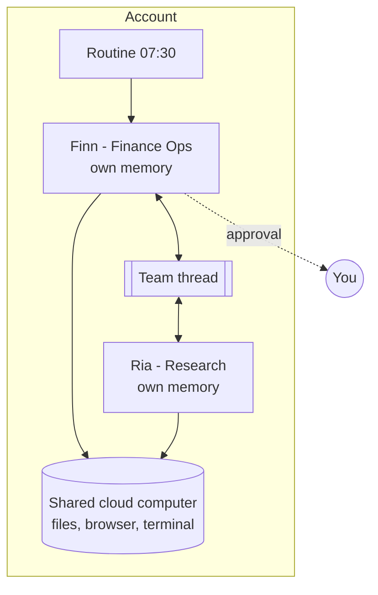

# 01 - Grok Bot (SpaceXAI / xAI, on Cursor infrastructure)

## What it is

Persistent, named Bots (a name, a job title, a description) that work on a persistent cloud computer with a browser, filesystem and terminal. Bots share that computer but keep their own memory, learn a routine when you walk them through a task once, run Routines on a schedule, coordinate with each other, and ask before sensitive steps. They reach apps through connectors, plugins and MCP, and through computer use when no connector exists. Early beta opened on Aug 11 2026, for macOS, Windows, Linux and iOS.

## What you can program

**No public Grok Bot API** (no list/create bot, send message, read reply). Two official programmable surfaces exist: the **xAI API** via `xai-sdk` (server-side tools `web_search`, `x_search`, `code_execution` plus your own client-side tools), and the **Cursor Python SDK** cloud agents, the runtime family Grok Bot lives on.

## Architecture



## How the example maps to it

| Concept | In `grok_bot.py` |
|---|---|
| Shared computer | `GrokBotAccount.computer` (one `SandboxComputer`) |
| Per-Bot memory | `Memory(spec.name, ...)` per Bot |
| Teach once | `GrokBotAccount.teach()` writes `skills/<name>/SKILL.md` |
| Routines | `Scheduler` + `Routine(at='07:30')` |
| Bot-to-Bot | `ask_bot` tool + `thread` |
| Approvals | `ApprovalGate(RISK_BASED)`; the scripted you refuses `pay` |
| Live Bot | `LiveGrokBot`: xai-sdk chat, server + client tools, `~/.grokbots/<name>.json` |

## Run it

```bash
# offline mock (no keys)
python -m services.s01_grok_bot.grok_bot
```

```bash
# live
pip install xai-sdk   # optional: cursor-sdk
export XAI_API_KEY=...  # optional: CURSOR_API_KEY=crsr_...
python -m services.s01_grok_bot.grok_bot --live
```

## Notes

- Server-side tool calls run on xAI's servers; only `client_side_tool` calls come back to your loop. Check with `get_tool_call_type`.
- xAI says separate Bots are not separate security boundaries. The mock mirrors that: one computer, one skills folder.
- The model name defaults to `grok-4.7`; set `XAI_MODEL` to whatever your account has.

Back to the [main README](../../README.md).
