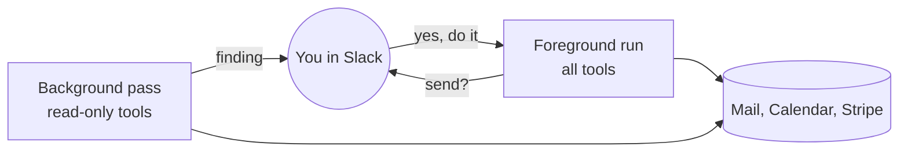

# 02 - dots (OpenAI)

## What it is

Always-on personal agents in ChatGPT, launched at DevDay on Sep 29 2026 for Pro and Business Premium. You start with a primary dot, name it, and connect calendar, email, your computer and other tools. It works in the background without prompting, and you can message it from ChatGPT, Codex, Slack and Teams. Specialist dots with their own identities and teams of dots are planned.

## What you can program

No public dots API. The live mode is a build-alike on the **OpenAI Agents SDK** (`openai-agents`).

## Architecture



## How the example maps to it

| Concept | In `dots.py` |
|---|---|
| Read-only background research | `ApprovalMode.DENY_ALL` and `ToolRegistry.subset(Risk.READ)`; `send_email` isn't even offered |
| Prepare then act after approval | `ApprovalMode.RISK_BASED` |
| Primary dot with memory | `Memory('Pip')` shared by both runs |
| Live | two `agents.Agent`s: a read-only background agent and an approval-gated foreground agent |

## Run it

```bash
# offline mock (no keys)
python -m services.s02_openai_dots.dots
```

```bash
# live
pip install openai-agents
export OPENAI_API_KEY=...
python -m services.s02_openai_dots.dots --live
```

## Notes

- OpenAI says dots' unprompted background research uses read-only tools, so it can't send messages, change apps or drive a browser. Copy that rule.
- The mock's proactive pass finds a real mismatch in the seed data: PyConf confirmed Wednesday Dec 9, the calendar says Tuesday.

Back to the [main README](../../README.md).
