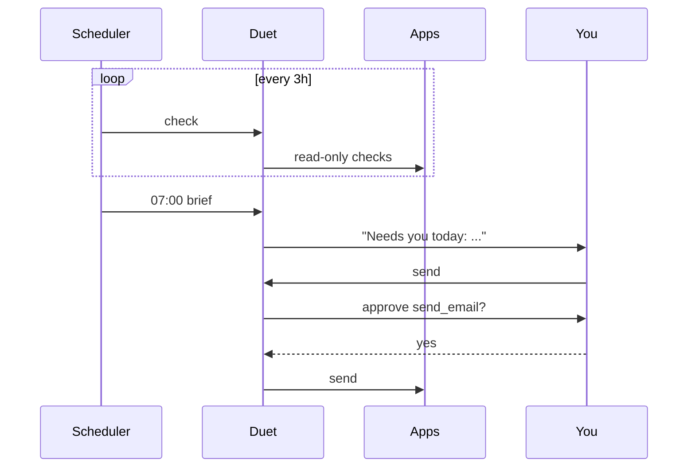

# 03 - Claude Duet (Anthropic)

## What it is

A research preview (Oct 21 2026, US Pro and Max, waitlist) of Claude as a proactive agent you message like a person. It sends a short morning brief across connected apps, checks connected accounts every few hours instead of continuously, uses the same memories, skills and connectors as regular Claude, keeps working on a cloud computer after the app closes, and has Stripe (unpaid invoices, drafted reminders) and Link / Shop Pay (purchases with approval) integrations. Runs on Claude Opus 5.5.

## What you can program

No public Duet API. The live mode rebuilds the pattern with the **Claude Agent SDK**: in-process MCP tools, a `can_use_tool` permission callback, a multi-turn `ClaudeSDKClient`.

## Architecture



## How the example maps to it

| Concept | In `claude_duet.py` |
|---|---|
| Every few hours | `Routine('check-connected-apps', every_minutes=180)` |
| Morning brief | `Routine('morning-brief', at='07:00')` |
| Needs your attention | the `attention` list built by the checks |
| Act with approval | `ApprovalMode.RISK_BASED`; live: `can_use_tool` returns `PermissionResultDeny` |

## Run it

```bash
# offline mock (no keys)
python -m services.s03_claude_duet.claude_duet
```

```bash
# live
pip install claude-agent-sdk
export ANTHROPIC_API_KEY=...
python -m services.s03_claude_duet.claude_duet --live
```

## Notes

- Anthropic says the background work counts against the same usage limits as chat. Cheap read-only checks plus one brief is the economical shape.
- In the SDK, MCP tool names look like `mcp__<server>__<tool>`; match on that in `can_use_tool` and `allowed_tools`.

Back to the [main README](../../README.md).
