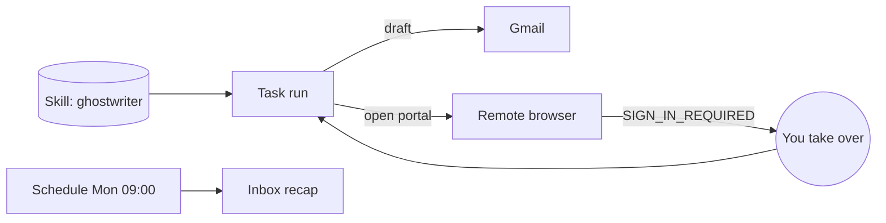

# 04 - Gemini Task (Google, formerly Gemini Spark)

## What it is

Google's personal agent, launched as Gemini Spark in May 2026 and renamed Task in the autumn (now a Chat | Task toggle, with a Scheduled page). Three primitives: **Tasks**, **Schedules** ("Every Monday at 9:00 AM..."), **Skills** ("turn my last 50 emails into a style guide called ghostwriter"). It connects to Gmail, Calendar, Docs, Sheets, Slides, Keep and Tasks, browses with Chrome auto browse or a remote browser, asks before browsing, and stops for you to take over at sign-in pages or when sensitive info is needed.

## What you can program

No public Task API. The Google-native way to build the same thing is **ADK** + Gemini; ADK's `before_tool_callback` is the approval hook.

## Architecture



## How the example maps to it

| Concept | In `gemini_task.py` |
|---|---|
| Skills | `SkillStore` with `ghostwriter`, injected into the system prompt |
| Take-over at sign-in | `SandboxComputer.open()` returns `SIGN_IN_REQUIRED`; `take_over` tool pauses for you |
| Schedules | `Routine('monday-recap', at='09:00')` |
| Confirm major actions | live: ADK `before_tool_callback` returning a dict skips the real tool |

## Run it

```bash
# offline mock (no keys)
python -m services.s04_gemini_task.gemini_task
```

```bash
# live
pip install google-adk
export GOOGLE_API_KEY=...
python -m services.s04_gemini_task.gemini_task --live
```

## Notes

- Google's help page tells users not to type sign-in or payment details into the task thread; take over the browser instead. The `take_over` tool encodes that.

Back to the [main README](../../README.md).
