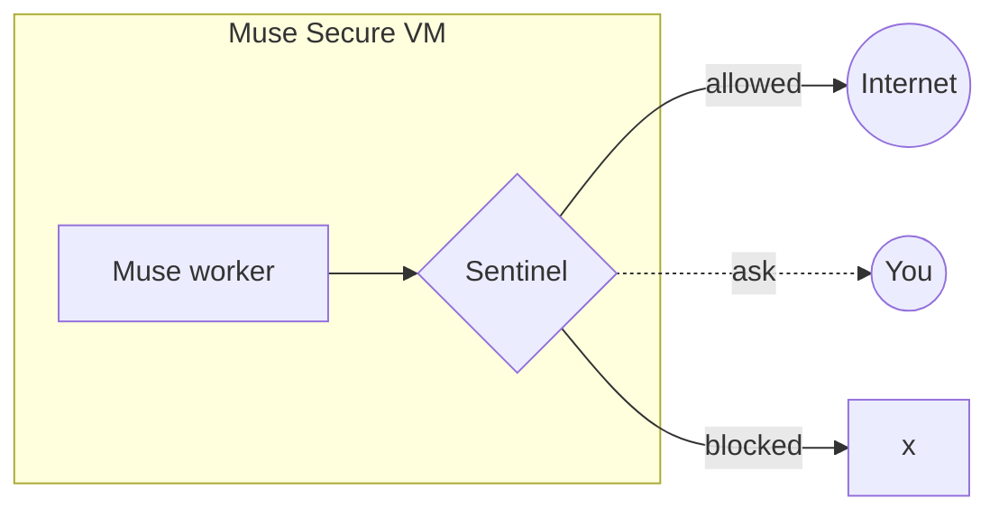

# 05 - Muse (Meta)

## What it is

Meta's personal agent (Sep 8 2026), powered by Muse Spark. Each person's Muse runs on **Muse Secure VM**, a dedicated VM holding the agent and that person's data and credentials. A separate **Sentinel** agent runs on the same machine, kept apart from Muse at the system level: nothing Muse does reaches the internet unless Sentinel approves it, and Sentinel asks the person when needed. Purchases go through Link by Stripe. Available as an app, at muse.ai and in WhatsApp; free tier plus $20 and $100 plans.

## What you can program

No public API. Mock = the architecture. Live = the same worker + Sentinel design on any OpenAI-compatible model.

## Architecture



## How the example maps to it

| Concept | In `muse.py` |
|---|---|
| Secure VM | `MuseSecureVM` builds the agent *and* its Sentinel; the agent can't configure its own checker |
| Sentinel | `Sentinel(allowed_domains, allowed_channels, blocked_terms, human)` |
| Worker doesn't gate | `ApprovalGate(ApprovalMode.AUTO)` on purpose; control is at egress |
| Link checkout caps | `Budget(limit=100)` |

## Run it

```bash
# offline mock (no keys)
python -m services.s05_meta_muse.muse
```

```bash
# live
export PA_BASE_URL=... PA_API_KEY=... PA_MODEL=...
python -m services.s05_meta_muse.muse --live
```

## Notes

- The injected page in the mock tries to email a card number to a look-alike domain. The Sentinel never reads the page; it only sees the outgoing action, which is why the trick doesn't work on it.

Back to the [main README](../../README.md).
