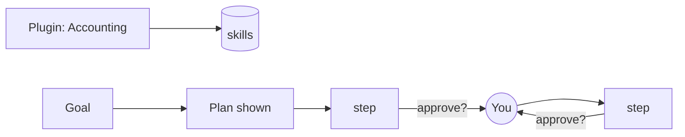

# 06 - Microsoft 365 Copilot Cowork

## What it is

Cowork carries out tasks across Microsoft 365: sends email, schedules meetings, creates documents, posts in Teams, manages your calendar. It grounds on your work context, plans, then executes, and **you approve each action before it happens**. Skills load during a session (shown in a side panel); plugins from the Microsoft 365 App Store add skills and connectors (Accounting, Finance, Capital Markets). Generally available since Jun 16 2026, usage-based billing, and at GA it ran on Anthropic models.

## What you can program

No public "run a Cowork task" API; extension is through plugins, Copilot Studio and Agent 365. Live = the same approve-every-action loop on any OpenAI-compatible endpoint, including Azure OpenAI.

## Architecture



## How the example maps to it

| Concept | In `copilot_cowork.py` |
|---|---|
| Approve every action | `ApprovalMode.EVERY` |
| Plan first | `show_plan` tool as the first step |
| Plugins add skills | `ACCOUNTING_PLUGIN` -> `SkillStore` |

## Run it

```bash
# offline mock (no keys)
python -m services.s06_copilot_cowork.copilot_cowork
```

```bash
# live
export PA_BASE_URL=https://<your-azure-openai>/openai/v1 PA_API_KEY=... PA_MODEL=<deployment>
python -m services.s06_copilot_cowork.copilot_cowork --live
```

## Notes

- Approving everything is safe and slow. The mock counts 6 prompts for one morning routine; that's the trade-off Microsoft chose for enterprise.

Back to the [main README](../../README.md).
