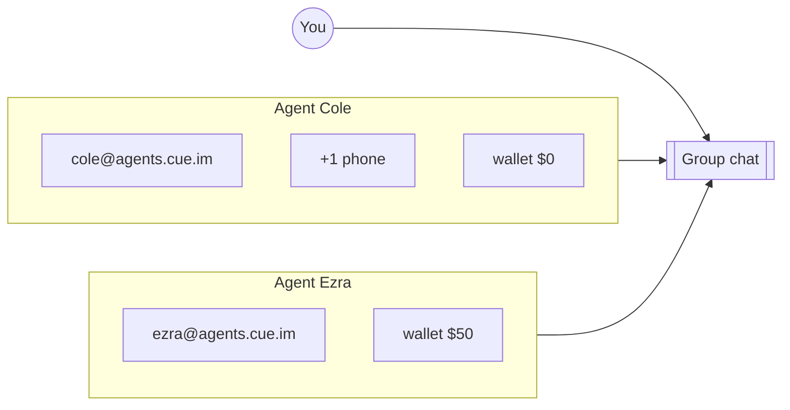

# 07 - Cue (Manus)

## What it is

Launched with Manus 2.0 on Sep 28 2026. Each Cue agent has its **own email address, phone number, wallet and computer**. It can take forwarded calls and summarize them, send and receive mail from its own address, pay within limits you set, and keep working after you log off. Several agents can join one group chat and hand work to each other while you steer.

## What you can program

No separate public Cue API was documented at launch; live mode sends the work to the **Manus v2 API** (`s11`) with identity rules in the task.

## Architecture



## How the example maps to it

| Concept | In `cue.py` |
|---|---|
| Per-agent identity | `Identity(email, phone, wallet, computer)` |
| Own address | `send_as_agent` sends from the agent's email, never yours |
| Calls | `take_call` writes a summary |
| Wallet | `Budget` per agent; Ezra's $40 upgrade is refused with $26 left |
| Group chat | `group_chat` tool |

## Run it

```bash
# offline mock (no keys)
python -m services.s07_manus_cue.cue
```

```bash
# live
export MANUS_API_KEY=...
python -m services.s07_manus_cue.cue --live
```

## Notes

- Identity separation is a blast-radius control: the test asserts the user's own outbox stays empty.

Back to the [main README](../../README.md).
