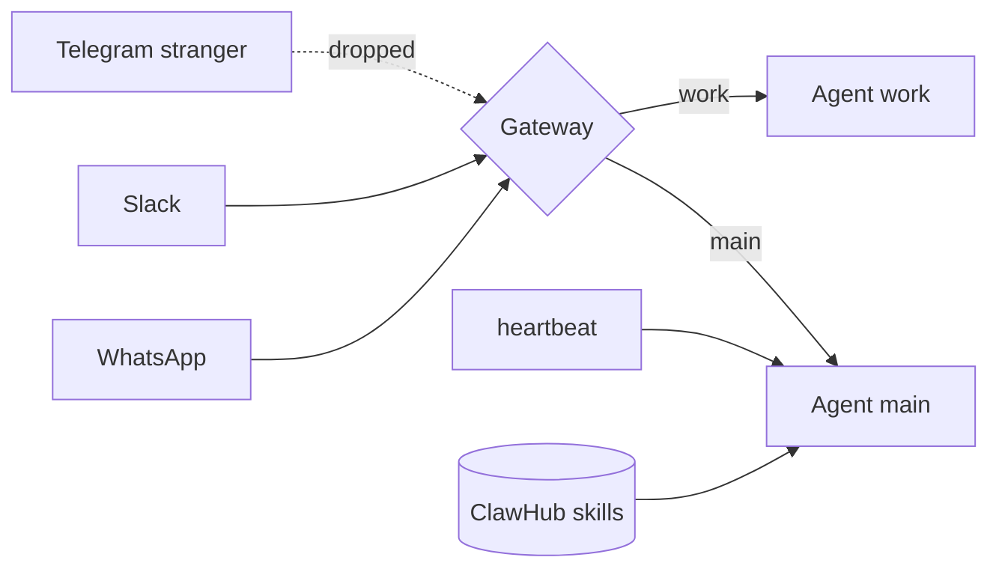

# 08 - OpenClaw (open source)

## What it is

A personal AI assistant you run on your own devices (MIT licensed, formerly Clawdbot, then Moltbot). It answers on the channels you already use (WhatsApp, Telegram, Slack, Discord, Signal, iMessage, Teams, Matrix, WebChat...), routes channels and peers to isolated agents with their own workspaces and sessions, runs heartbeats and cron, installs skills from ClawHub, and works with Claude, GPT and other models. Main-session tools run on the host with full access, so run it somewhere you're comfortable with that.

## What you can program

The Gateway can serve OpenAI-compatible endpoints, including an OpenResponses `POST /v1/responses` (disabled by default, full operator access once authenticated). Select an agent with `model="openclaw:<agentId>"`; pass `user` for a stable session.

## Architecture



## How the example maps to it

| Concept | In `openclaw.py` |
|---|---|
| Gateway | `Gateway` class: `routes`, `owner_ids`, `dm_policy`, `sessions` |
| Isolated agents | two `AutonomousAgent`s with separate memory |
| DM allowlist | `inbound()` drops unknown peers unless `dm_policy='open'` |
| Heartbeats | `Routine('heartbeat', every_minutes=60)` |
| ClawHub | `SkillStore` with `invoice-chaser` |

## Run it

```bash
# offline mock (no keys)
python -m services.s08_openclaw.openclaw
```

```bash
# live
# in OpenClaw config: gateway.http.endpoints.responses.enabled = true
export OPENCLAW_GATEWAY_URL=http://127.0.0.1:18789 OPENCLAW_GATEWAY_TOKEN=...
python -m services.s08_openclaw.openclaw --live
```

## Notes

- Use the port your gateway prints; 18789 is just the example default here.
- Anyone with the gateway token is an operator. Don't expose the endpoint publicly.

Back to the [main README](../../README.md).
