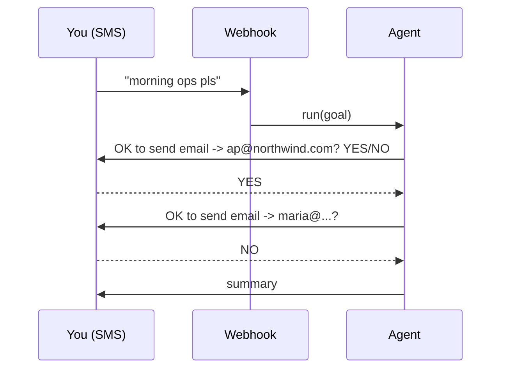

# 09 - Instinct (Spear Street Technology)

## What it is

An invite-only personal agent you **text or call**: no new interface. It connects to mail, messaging, calendar and devices, is trained to use a phone and a computer like a person, and runs on a persistent cloud computer with cached credentials on the company's servers. Not self-hostable; no published pricing; privacy is the main criticism.

## What you can program

No public API. Mock = an SMS thread in front of the agent loop with approvals inside the thread. Live = the same with a real model; point `on_sms` at a Twilio-style webhook to make it real.

## Architecture



## How the example maps to it

| Concept | In `instinct.py` |
|---|---|
| Text interface | `SmsThread` |
| In-thread approval | `ask_by_text` as the gate's `human` |
| Webhook | `InstinctLike.on_sms(body)` |

## Run it

```bash
# offline mock (no keys)
python -m services.s09_instinct.instinct
```

```bash
# live
export PA_BASE_URL=... PA_API_KEY=... PA_MODEL=...
python -m services.s09_instinct.instinct --live
```

## Notes

- If you build this for real, put a timeout on approvals and treat silence as NO.

Back to the [main README](../../README.md).
