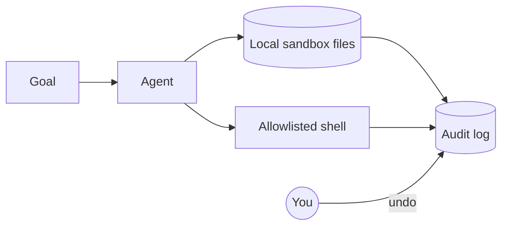

# 10 - Perplexity Personal Computer

## What it is

A local agent harness (Mac in April 2026, Windows in July) that orchestrates sub-agents across your local files, native apps and the web, connected to Perplexity's servers and many frontier models. Recommended on an always-on Mac mini. The safety pitch: explicit approval for sensitive actions, a complete audit log, files in a secure sandbox, actions that are auditable and reversible. Perplexity opened four of the APIs behind it: Search, Agent, Embeddings, Sandbox.

## What you can program

The **Agent API** (`POST /v1/agent`, also `/v1/responses` for OpenAI SDK compatibility) via `pip install perplexityai`, with presets such as `pro-search`.

## Architecture



## How the example maps to it

| Concept | In `personal_computer.py` |
|---|---|
| Sandbox files | `SandboxComputer.files` |
| Audit log | `SandboxComputer.audit_report()` |
| Reversible | every write stores an undo closure; `undo_last()` |
| Shell guard | `rm` isn't on the allowlist, so it's logged as `shell_denied` |
| Live research | `Perplexity().responses.create(preset='pro-search', input=...)` then `resp.output_text` |

## Run it

```bash
# offline mock (no keys)
python -m services.s10_perplexity_personal_computer.personal_computer
```

```bash
# live
pip install perplexityai
export PERPLEXITY_API_KEY=...
python -m services.s10_perplexity_personal_computer.personal_computer --live
```

## Notes

- Reversibility is a property of each tool, not of the agent. Design write tools so they can record how to undo themselves.

Back to the [main README](../../README.md).
