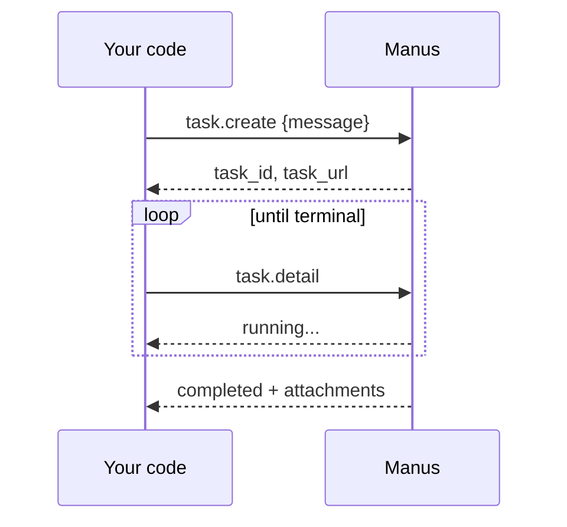

# 11 - Manus (autonomous task execution)

## What it is

A general agent platform: hand it a task, it plans and works on its own cloud computer (browser, code, files) and returns results and attachments. Manus 2.0 (Sep 28 2026) added Cascade, Studio, Automations and the Cue app.

## What you can program

REST **v2**: `POST /v2/task.create`, `GET /v2/task.detail`, `GET /v2/task.listMessages`, `POST /v2/task.sendMessage`. Header `x-manus-api-key` (or OAuth for Open Apps). Responses are wrapped as `{"ok": true, "request_id": ...}`. Files are deleted 48 hours after upload. Webhooks for production. There's also an OpenAI-compatible Responses surface.

## Architecture



## How the example maps to it

| Concept | In `manus.py` |
|---|---|
| Client | `ManusClient` (create, detail, messages, send, wait) |
| Envelope errors | `_check()` raises on `ok: false` with the `request_id` |
| Mock server | `FakeManus` with the same lifecycle |

## Run it

```bash
# offline mock (no keys)
python -m services.s11_manus.manus
```

```bash
# live
pip install requests
export MANUS_API_KEY=...
python -m services.s11_manus.manus --live
```

## Notes

- Status names and the exact detail envelope are read defensively (`status_of`). Check the current reference if polling never ends.

Back to the [main README](../../README.md).
