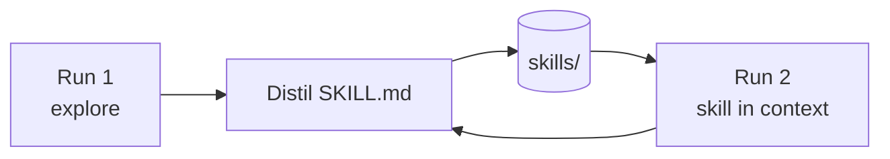

# 12 - Hermes Agent (Nous Research)

## What it is

An open-source (MIT) self-improving agent launched Feb 26 2026: terminal-native, persistent memory in `~/.hermes`, a messaging gateway, built-in cron that delivers to any platform, subagents, and a **closed learning loop** that creates and refines skills from experience. Skills use the portable SKILL.md format and can come from community hubs with quarantine and audit. Works with Nous Portal, OpenRouter, OpenAI or any endpoint.

## What you can program

It's a harness you install (`curl -fsSL https://hermes-agent.nousresearch.com/install.sh | bash`). I didn't find a documented programmatic API, so live mode reproduces the learning loop on pa_core with a real model.

## Architecture



## How the example maps to it

| Concept | In `hermes.py` |
|---|---|
| Learning loop | `AutonomousAgent(learn_skills=True)` writes a skill in `_reflect()` |
| Skill reuse | `SkillStore.match(goal)` injects it into the next system prompt |
| Memory on disk | `Memory('hermes', home)` JSON |

## Run it

```bash
# offline mock (no keys)
python -m services.s12_hermes_agent.hermes
```

```bash
# live
export PA_BASE_URL=https://openrouter.ai/api/v1 PA_API_KEY=... PA_MODEL=...
python -m services.s12_hermes_agent.hermes --live
```

## Notes

- Auto-written skills are code you didn't review. Hermes quarantines hub skills for that reason; review self-written ones before trusting them with external actions.

Back to the [main README](../../README.md).
