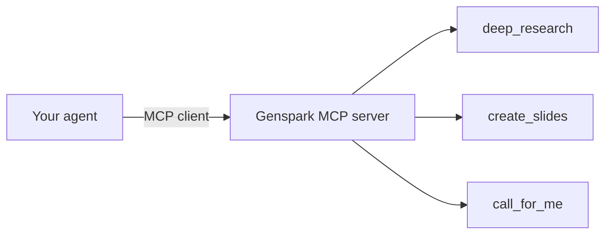

# 13 - Genspark (AI workspace and agents)

## What it is

An AI workspace that pivoted from search to no-code personal agents: AI Slides, Sheets, Docs, "Call For Me" phone calls, an AI browser, Genspark Claw, and a mixture-of-agents engine that cross-checks several frontier models.

## What you can program

A hosted **remote MCP server** at `/api/mcp` on Genspark's host, over streamable HTTP, behind OAuth 2.1 (authorization code + PKCE, refresh tokens, dynamic client registration). No widely documented REST API beyond that.

## Architecture



## How the example maps to it

| Concept | In `genspark.py` |
|---|---|
| MCP server | `FakeMCPServer` (list_tools / call_tool) |
| Adapter | `mcp_tools_as_local()` turns remote tools into `Tool`s with risk levels |
| Live client | `mcp` SDK `ClientSession` over streamable HTTP with a bearer token; works with mcp 1.x and 2.x |

## Run it

```bash
# offline mock (no keys)
python -m services.s13_genspark.genspark
```

```bash
# live
pip install mcp httpx
export GENSPARK_MCP_URL=... GENSPARK_MCP_TOKEN=...  # token from Genspark's OAuth flow
python -m services.s13_genspark.genspark --live
```

## Notes

- The adapter is the reusable part: any MCP server becomes agent tools the same way. Assign risk levels yourself; MCP annotations are hints, not guarantees.

Back to the [main README](../../README.md).
