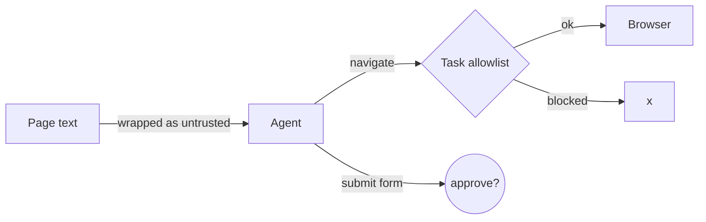

# 14 - Perplexity Comet (AI browser)

## What it is

A Chromium browser with an agent built in. It reads the page you're on and can click, type and navigate with your signed-in sessions. That's the power and the risk: every page is untrusted input, and indirect prompt injection is the main attack on browser agents.

## What you can program

No public automation API. Live mode shows the open equivalent: Playwright reads the page, the agent decides, read-only by default.

## Architecture



## How the example maps to it

| Concept | In `comet.py` |
|---|---|
| Untrusted content | `<untrusted_page>` wrapping + injection heuristics |
| Allowlist per task | `CometLikeBrowser(allowed_hosts)` |
| Confirm submits | `submit_form` is `Risk.EXTERNAL` |

## Run it

```bash
# offline mock (no keys)
python -m services.s14_perplexity_comet.comet
```

```bash
# live
pip install playwright openai && playwright install chromium
export PA_BASE_URL=... PA_API_KEY=... PA_MODEL=...
python -m services.s14_perplexity_comet.comet --live
```

## Notes

- The injection check is a heuristic for logging. The allowlist is what actually stops the exfiltration.

Back to the [main README](../../README.md).
