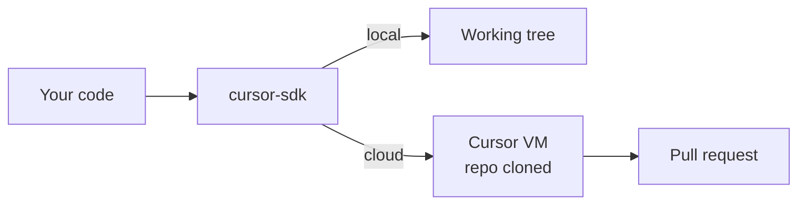

# 15 - Cursor (coding agent, local and cloud)

## What it is

Cursor's agent runs locally against your working tree or in an isolated Cursor-hosted VM with your repo cloned in. The Python SDK hides the difference. The same cloud infrastructure hosts Grok Bot, and Cursor's Agent SDK (`@grok/agent-sdk`) deploys agents-as-code.

## What you can program

`pip install cursor-sdk`: `Agent.create(local=LocalAgentOptions(cwd=...))` or `Agent.create(cloud=CloudAgentOptions(repos=[CloudRepository(url, starting_ref)]))`, then `agent.send(prompt).wait().result`. REST: Cloud Agents API `POST /v1/agents` (public beta).

## Architecture



## How the example maps to it

| Concept | In `cursor_agent.py` |
|---|---|
| Run lifecycle | `FakeCloudRun.wait()` |
| Live | local runtime by default; cloud if `CURSOR_REPO_URL` is set |

## Run it

```bash
# offline mock (no keys)
python -m services.s15_cursor.cursor_agent
```

```bash
# live
pip install cursor-sdk
export CURSOR_API_KEY=crsr_...  # optional CURSOR_REPO_URL
python -m services.s15_cursor.cursor_agent --live
```

## Notes

- The Cloud Agents API runs agent workflows; it isn't a chat-completions endpoint.

Back to the [main README](../../README.md).
