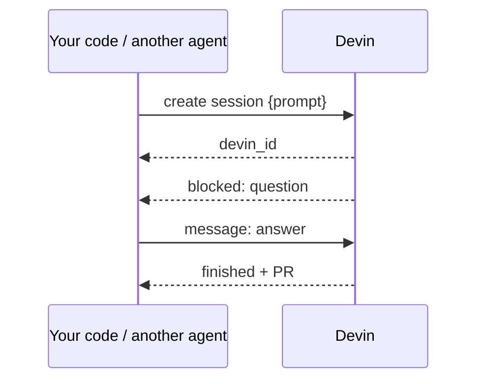

# 16 - Devin (Cognition)

## What it is

An autonomous software engineer. A session is a cloud machine with a shell, editor and browser that works a prompt until it's done, asking in the session thread when it's blocked.

## What you can program

REST **v3** with service users and RBAC (keys start with `cog_`): `POST /v3/organizations/{org_id}/sessions`, `GET .../sessions/{devin_id}`, `POST .../sessions/{id}/messages`, plus knowledge notes, playbooks, attachments and scheduled sessions.

## Architecture



## How the example maps to it

| Concept | In `devin.py` |
|---|---|
| Client | `DevinClient` (create, get, message, wait) |

## Run it

```bash
# offline mock (no keys)
python -m services.s16_devin.devin
```

```bash
# live
export DEVIN_API_KEY=cog_... DEVIN_ORG_ID=...
python -m services.s16_devin.devin --live
```

## Notes

- Because one HTTP call creates a session, any agent in this repo can hand coding work to Devin as a tool.

Back to the [main README](../../README.md).
