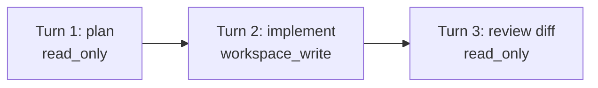

# 17 - OpenAI Codex (Python SDK)

## What it is

OpenAI's coding agent. The Python SDK controls a local Codex app-server over JSON-RPC and ships a pinned runtime. Threads hold state; each turn can change the sandbox.

## What you can program

`pip install openai-codex`: `Codex()`, `thread_start(model, sandbox, approval_mode, cwd)`, `thread.run(prompt, sandbox=...)`, `result.final_response`. Sandboxes: `read_only`, `workspace_write`, `full_access`. Approval modes: `auto_review` (default), `deny_all`.

## Architecture



## How the example maps to it

| Concept | In `codex_agent.py` |
|---|---|
| Per-turn sandbox | the three-turn pattern in `run_live` |

## Run it

```bash
# offline mock (no keys)
python -m services.s17_openai_codex.codex_agent
```

```bash
# live
pip install openai-codex
export OPENAI_API_KEY=...   # or sign in with ChatGPT
python -m services.s17_openai_codex.codex_agent --live
```

## Notes

- Plan read-only, implement with write access, review read-only. Least privilege per turn costs nothing.

Back to the [main README](../../README.md).
