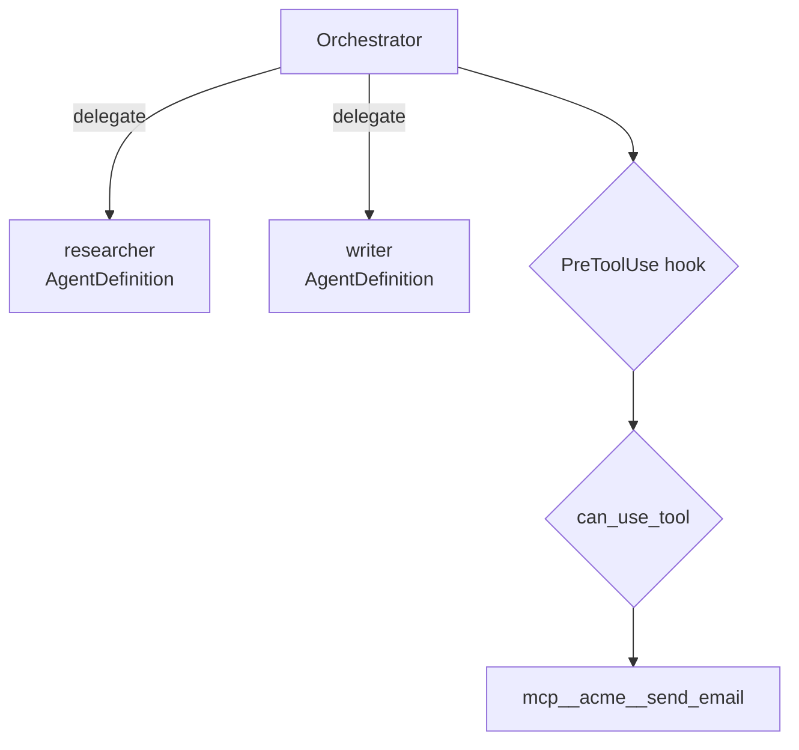

# 18 - Claude Agent SDK (Anthropic)

## What it is

The Claude Code harness as a Python library. `query()` for one-shot runs, `ClaudeSDKClient` for multi-turn sessions with custom tools and hooks, `@tool` + `create_sdk_mcp_server` for in-process tools, `AgentDefinition` for subagents, `HookMatcher` for `PreToolUse`/`PostToolUse` hooks, and `ClaudeAgentOptions` for everything else (`allowed_tools`, `permission_mode`, `can_use_tool`, `max_turns`, `max_budget_usd`, `resume`, `skills`, `sandbox`...).

## What you can program

`pip install claude-agent-sdk` (Python 3.10+).

## Architecture



## How the example maps to it

| Concept | In `claude_agent.py` |
|---|---|
| Subagents | `agents={'researcher': AgentDefinition(...), 'writer': ...}` |
| Sentinel | `PreToolUse` hook returning `permissionDecision: deny` |
| Approval | `can_use_tool` -> `PermissionResultAllow/Deny` |
| Budget | `max_budget_usd`, `max_turns` |

## Run it

```bash
# offline mock (no keys)
python -m services.s18_claude_agent_sdk.claude_agent
```

```bash
# live
pip install claude-agent-sdk
export ANTHROPIC_API_KEY=...
python -m services.s18_claude_agent_sdk.claude_agent --live
```

## Notes

- Hooks run before permission checks; use hooks for hard rules and `can_use_tool` for asking a person.

Back to the [main README](../../README.md).
