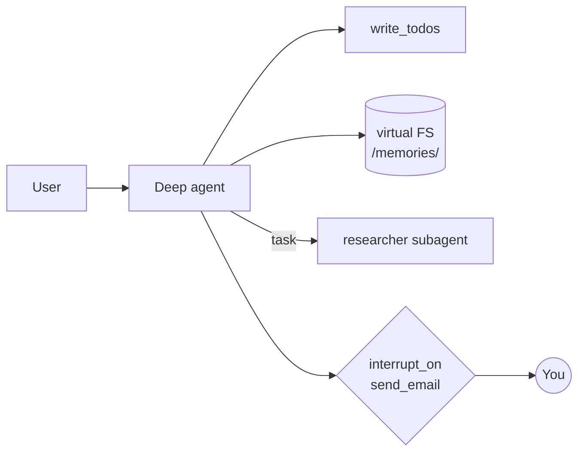

# 19 - LangChain Deep Agents

## What it is

An opinionated harness on LangGraph: a todo/planning tool, a virtual filesystem with pluggable backends, subagents through a task tool, skills and memory files, and human-in-the-loop interrupts. Model-agnostic.

## What you can program

`create_deep_agent(model, tools, system_prompt, subagents=[{name, description, system_prompt, tools, model}], interrupt_on={...}, checkpointer=..., backend=..., skills=[...], memory=[...])`. Resume an interrupt with `Command(resume={"decisions": [{"type": "approve"}]})`.

## Architecture



## How the example maps to it

| Concept | In `deep_agent.py` |
|---|---|
| Todos | `write_todos` tool |
| Virtual FS | `SandboxComputer` as the filesystem; `/memories/` path |
| Subagent | `task` tool spawning a fresh agent |
| interrupt_on | approval on `send_email`; live code loops on `__interrupt__` |

## Run it

```bash
# offline mock (no keys)
python -m services.s19_langchain_deep_agents.deep_agent
```

```bash
# live
pip install deepagents langgraph langchain-anthropic
export ANTHROPIC_API_KEY=...
python -m services.s19_langchain_deep_agents.deep_agent --live
```

## Notes

- `interrupt_on` needs a checkpointer and a `thread_id` in the config; without them there's nothing to resume.

Back to the [main README](../../README.md).
