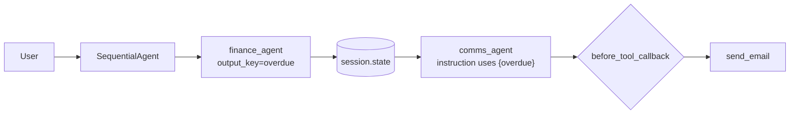

# 20 - Google Agent Development Kit (ADK)

## What it is

Google's framework for multi-agent systems: `Agent`/`LlmAgent`, workflow agents (`SequentialAgent`, `ParallelAgent`, `LoopAgent`), a `Runner` that yields Events, session services, shared `session.state` (an agent's `output_key` writes there), and before/after model and tool callbacks. Deploy with `adk web`, Cloud Run or Vertex AI Agent Engine. **ADK 2.0** (GA May 19 2026) turned ADK into a graph engine: `Workflow` with edges, routing, fan-out/join, retries, dynamic nodes and durable human-in-the-loop, and deprecated the classic Sequential/Parallel/Loop agents. See [frameworks/google_adk_workflows](../../frameworks/google_adk_workflows/README.md).

## What you can program

`pip install google-adk`; Gemini via `GOOGLE_API_KEY` or Vertex AI.

## Architecture



## How the example maps to it

| Concept | In `adk_agent.py` |
|---|---|
| output_key / state | `state['overdue']` handed to the next agent |
| before_tool_callback | the comms agent's gate approves Northwind and skips BrightPath |

## Run it

```bash
# offline mock (no keys)
python -m services.s20_google_adk.adk_agent
```

```bash
# live
pip install google-adk
export GOOGLE_API_KEY=...
python -m services.s20_google_adk.adk_agent --live
```

## Notes

- Returning a dict from `before_tool_callback` skips the real tool and hands that dict to the model as the result.

Back to the [main README](../../README.md).
