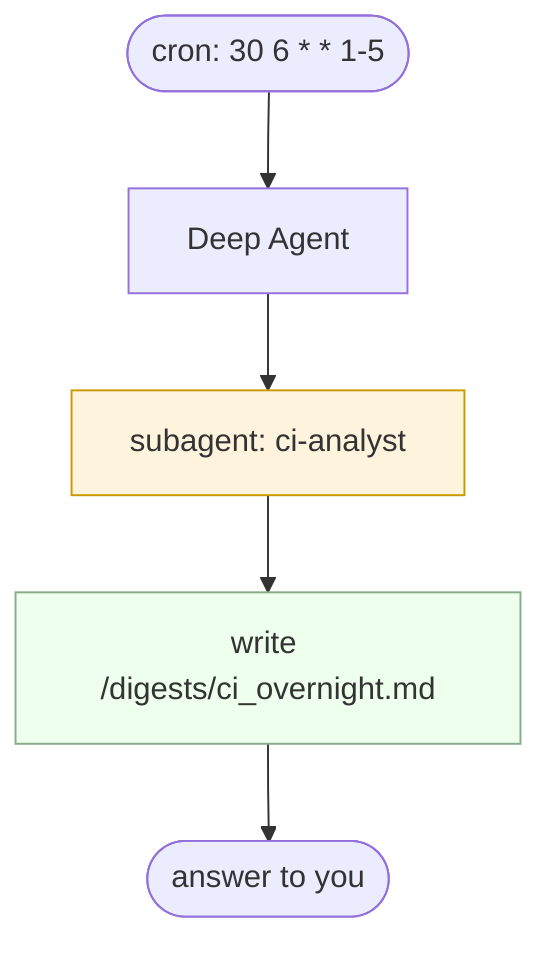

# 001. Overnight CI failure digest

**When:** 06:30 (morning)  
**Trigger:** `cron: 30 6 * * 1-5`  
**Type:** scheduled digest  
**Deep Agents features:** subagents, filesystem

Nobody should start the day by scrolling CI pages. A subagent groups failures by cause; only the summary reaches you.

## What you ask

> Summarize what broke in CI overnight on main and the release branches.

## Flow



## Tools

| Tool | What it does | Effect | Control |
|---|---|---|---|
| `list_failed_runs` | Failed CI runs in a time window. | read-only | - |

## Subagents

- **ci-analyst**: Groups CI failures by root cause. Tools: `list_failed_runs`.

## Run it

```bash
python usecases/swe_day/001_overnight_ci_failure_digest/usecase.py            # offline: scripted model, real Deep Agent
LC_MODEL=anthropic:claude-sonnet-4-6 python usecases/swe_day/001_overnight_ci_failure_digest/usecase.py --live   # a real model makes the decisions
```

## Taking it to production

- Schedule it with `30 6 * * 1-5` (cron, server time; prefix `CRON_TZ=...` for your zone). A LangGraph Platform cron job, a GitHub Actions `schedule:`, or a Kubernetes CronJob all work.
- Subagents run in their own context window, which keeps the main thread small. Give them a cheaper model if the job is just reading.
- Swap each `TOOL(..., returns=...)` for a real call (your API, a CLI, or an MCP server through `langchain-mcp-adapters`).
