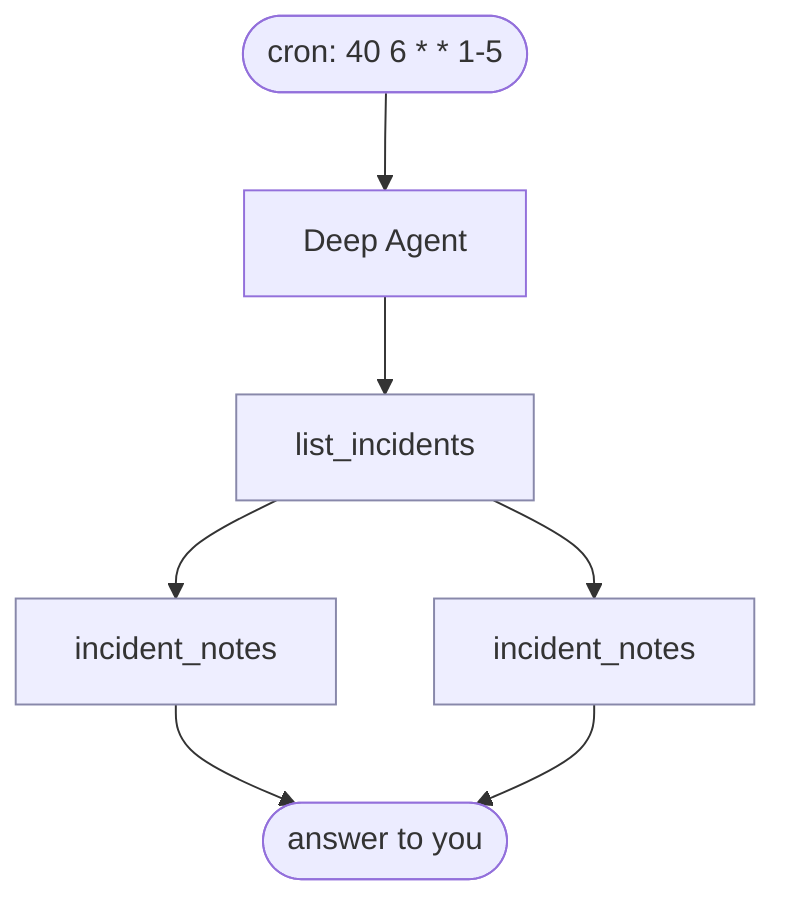

# 002. Overnight incident recap

**When:** 06:40 (morning)  
**Trigger:** `cron: 40 6 * * 1-5`  
**Type:** scheduled digest  
**Deep Agents features:** parallel calls

Pulls incidents and their timelines in parallel so you know the state of prod before standup.

## What you ask

> What paged overnight and is anything still open?

## Flow



## Tools

| Tool | What it does | Effect | Control |
|---|---|---|---|
| `list_incidents` | Incidents in a window. | read-only | - |
| `incident_notes` | Timeline notes for an incident. | read-only | - |

## Run it

```bash
python usecases/swe_day/002_pagerduty_overnight_recap/usecase.py            # offline: scripted model, real Deep Agent
LC_MODEL=anthropic:claude-sonnet-4-6 python usecases/swe_day/002_pagerduty_overnight_recap/usecase.py --live   # a real model makes the decisions
```

## Taking it to production

- Schedule it with `40 6 * * 1-5` (cron, server time; prefix `CRON_TZ=...` for your zone). A LangGraph Platform cron job, a GitHub Actions `schedule:`, or a Kubernetes CronJob all work.
- Swap each `TOOL(..., returns=...)` for a real call (your API, a CLI, or an MCP server through `langchain-mcp-adapters`).
