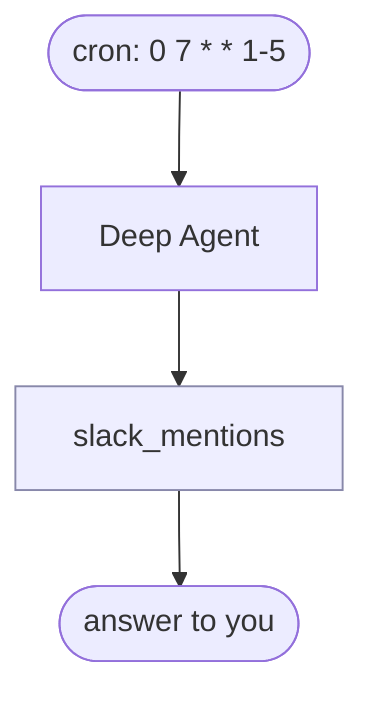

# 004. Slack mentions and DMs summary

**When:** 07:00 (morning)  
**Trigger:** `cron: 0 7 * * 1-5`  
**Type:** scheduled digest  
**Deep Agents features:** 

Separates what needs a reply from FYIs. Read-only: it never answers for you.

## What you ask

> Summarize my Slack mentions and DMs since yesterday evening.

## Flow



## Tools

| Tool | What it does | Effect | Control |
|---|---|---|---|
| `slack_mentions` | Mentions and DMs since a time. | read-only | - |

## Run it

```bash
python usecases/swe_day/004_slack_mentions_summary/usecase.py            # offline: scripted model, real Deep Agent
LC_MODEL=anthropic:claude-sonnet-4-6 python usecases/swe_day/004_slack_mentions_summary/usecase.py --live   # a real model makes the decisions
```

## Taking it to production

- Schedule it with `0 7 * * 1-5` (cron, server time; prefix `CRON_TZ=...` for your zone). A LangGraph Platform cron job, a GitHub Actions `schedule:`, or a Kubernetes CronJob all work.
- Swap each `TOOL(..., returns=...)` for a real call (your API, a CLI, or an MCP server through `langchain-mcp-adapters`).
