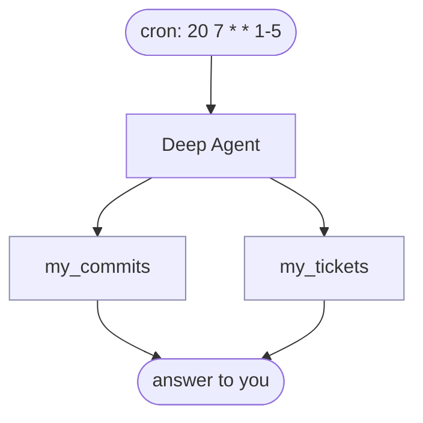

# 006. Standup notes from yesterday's activity

**When:** 07:20 (morning)  
**Trigger:** `cron: 20 7 * * 1-5`  
**Type:** auto-draft  
**Deep Agents features:** AGENTS.md, parallel calls

Builds yesterday/today/blockers from commits and tickets, in the team's format from AGENTS.md.

## What you ask

> Draft my standup update.

## Flow



## Tools

| Tool | What it does | Effect | Control |
|---|---|---|---|
| `my_commits` | My commits since a time. | read-only | - |
| `my_tickets` | My tickets by status. | read-only | - |

## House rules (AGENTS.md)

```markdown
# Standup format
Yesterday: ...
Today: ...
Blockers: ...
Max 3 lines each.
```

## Run it

```bash
python usecases/swe_day/006_standup_notes_from_activity/usecase.py            # offline: scripted model, real Deep Agent
LC_MODEL=anthropic:claude-sonnet-4-6 python usecases/swe_day/006_standup_notes_from_activity/usecase.py --live   # a real model makes the decisions
```

## Taking it to production

- Schedule it with `20 7 * * 1-5` (cron, server time; prefix `CRON_TZ=...` for your zone). A LangGraph Platform cron job, a GitHub Actions `schedule:`, or a Kubernetes CronJob all work.
- Swap each `TOOL(..., returns=...)` for a real call (your API, a CLI, or an MCP server through `langchain-mcp-adapters`).
