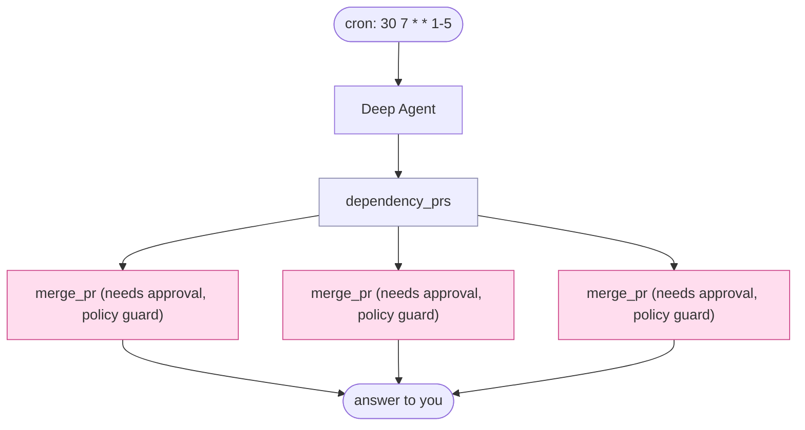

# 007. Dependabot PR batch triage

**When:** 07:30 (morning)  
**Trigger:** `cron: 30 7 * * 1-5`  
**Type:** auto-merge with approval  
**Deep Agents features:** HITL, guardrail, parallel calls

Patch bumps with green CI get merged after one approval for the batch; majors are left for a human.

## What you ask

> Handle this morning's dependency bump PRs.

## Flow



## Tools

| Tool | What it does | Effect | Control |
|---|---|---|---|
| `dependency_prs` | Open dependency PRs. | read-only | - |
| `merge_pr` | Merge a PR. | changes state | human approval, policy guard |

## Human decisions in the offline run

- `merge_pr`: approved

## Run it

```bash
python usecases/swe_day/007_dependabot_batch_triage/usecase.py            # offline: scripted model, real Deep Agent
LC_MODEL=anthropic:claude-sonnet-4-6 python usecases/swe_day/007_dependabot_batch_triage/usecase.py --live   # a real model makes the decisions
```

## Taking it to production

- Schedule it with `30 7 * * 1-5` (cron, server time; prefix `CRON_TZ=...` for your zone). A LangGraph Platform cron job, a GitHub Actions `schedule:`, or a Kubernetes CronJob all work.
- Approvals: the run pauses on an interrupt. In production, send the pending action to Slack or a web UI and resume with `Command(resume={'decisions': [...]})` on the same `thread_id`. You need a persistent checkpointer (Postgres) for this.
- Keep the guard. It's ordinary Python in middleware, so it holds even when the model gets it wrong.
- Swap each `TOOL(..., returns=...)` for a real call (your API, a CLI, or an MCP server through `langchain-mcp-adapters`).
