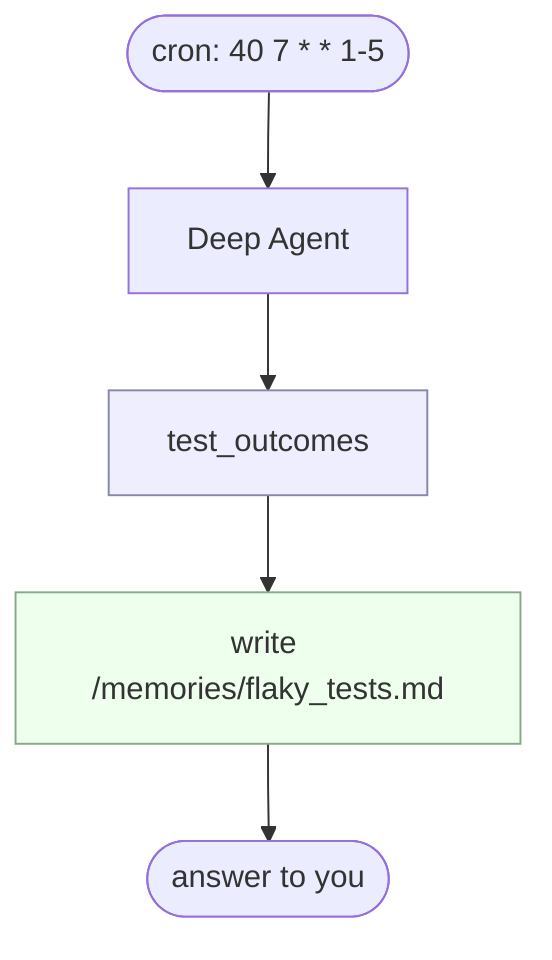

# 008. Flaky test report

**When:** 07:40 (morning)  
**Trigger:** `cron: 40 7 * * 1-5`  
**Type:** scheduled report  
**Deep Agents features:** long-term memory, filesystem

Finds tests that both passed and failed on the same commit and remembers the trend across days.

## What you ask

> Which tests flaked in the last 24 hours?

## Flow



## Tools

| Tool | What it does | Effect | Control |
|---|---|---|---|
| `test_outcomes` | Test outcomes by commit. | read-only | - |

## Run it

```bash
python usecases/swe_day/008_flaky_test_report/usecase.py            # offline: scripted model, real Deep Agent
LC_MODEL=anthropic:claude-sonnet-4-6 python usecases/swe_day/008_flaky_test_report/usecase.py --live   # a real model makes the decisions
```

## Taking it to production

- Schedule it with `40 7 * * 1-5` (cron, server time; prefix `CRON_TZ=...` for your zone). A LangGraph Platform cron job, a GitHub Actions `schedule:`, or a Kubernetes CronJob all work.
- `/memories/` maps to a LangGraph store. Use `PostgresStore` so the next run (or tomorrow's) can read it.
- Swap each `TOOL(..., returns=...)` for a real call (your API, a CLI, or an MCP server through `langchain-mcp-adapters`).
