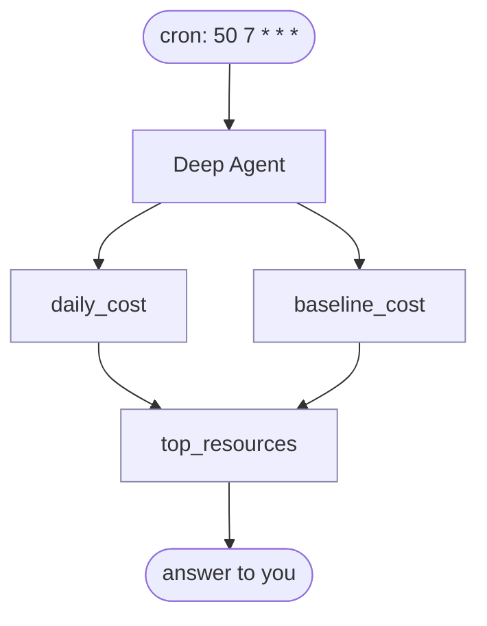

# 009. Overnight cloud cost anomaly

**When:** 07:50 (morning)  
**Trigger:** `cron: 50 7 * * *`  
**Type:** scheduled check  
**Deep Agents features:** parallel calls

Compares yesterday to the 7-day baseline per service and names the resource behind any spike.

## What you ask

> Did our AWS spend do anything weird overnight?

## Flow



## Tools

| Tool | What it does | Effect | Control |
|---|---|---|---|
| `daily_cost` | Daily cost by service. | read-only | - |
| `baseline_cost` | 7-day average by service. | read-only | - |
| `top_resources` | Top cost resources for a service. | read-only | - |

## Run it

```bash
python usecases/swe_day/009_aws_cost_anomaly_check/usecase.py            # offline: scripted model, real Deep Agent
LC_MODEL=anthropic:claude-sonnet-4-6 python usecases/swe_day/009_aws_cost_anomaly_check/usecase.py --live   # a real model makes the decisions
```

## Taking it to production

- Schedule it with `50 7 * * *` (cron, server time; prefix `CRON_TZ=...` for your zone). A LangGraph Platform cron job, a GitHub Actions `schedule:`, or a Kubernetes CronJob all work.
- Swap each `TOOL(..., returns=...)` for a real call (your API, a CLI, or an MCP server through `langchain-mcp-adapters`).
