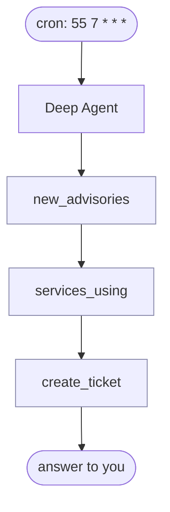

# 010. New security advisories for our dependencies

**When:** 07:55 (morning)  
**Trigger:** `cron: 55 7 * * *`  
**Type:** scheduled scan  
**Deep Agents features:** 

Matches new advisories against each service's lockfile and opens tickets only for reachable ones.

## What you ask

> Any new CVEs affecting our services?

## Flow



## Tools

| Tool | What it does | Effect | Control |
|---|---|---|---|
| `new_advisories` | Advisories published in the last day. | read-only | - |
| `services_using` | Services that depend on a package and version. | read-only | - |
| `create_ticket` | Create a Jira ticket. | changes state | - |

## Run it

```bash
python usecases/swe_day/010_dependency_security_advisories/usecase.py            # offline: scripted model, real Deep Agent
LC_MODEL=anthropic:claude-sonnet-4-6 python usecases/swe_day/010_dependency_security_advisories/usecase.py --live   # a real model makes the decisions
```

## Taking it to production

- Schedule it with `55 7 * * *` (cron, server time; prefix `CRON_TZ=...` for your zone). A LangGraph Platform cron job, a GitHub Actions `schedule:`, or a Kubernetes CronJob all work.
- Swap each `TOOL(..., returns=...)` for a real call (your API, a CLI, or an MCP server through `langchain-mcp-adapters`).
