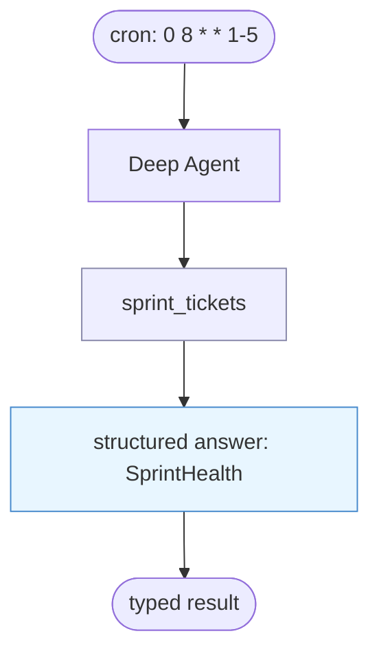

# 011. Sprint board health check

**When:** 08:00 (morning)  
**Trigger:** `cron: 0 8 * * 1-5`  
**Type:** scheduled check  
**Deep Agents features:** structured output

Spots blocked and stale tickets early. Typed output feeds a team dashboard.

## What you ask

> Is the sprint on track?

## Flow



## Tools

| Tool | What it does | Effect | Control |
|---|---|---|---|
| `sprint_tickets` | Tickets in the active sprint. | read-only | - |

## Run it

```bash
python usecases/swe_day/011_sprint_board_health/usecase.py            # offline: scripted model, real Deep Agent
LC_MODEL=anthropic:claude-sonnet-4-6 python usecases/swe_day/011_sprint_board_health/usecase.py --live   # a real model makes the decisions
```

## Taking it to production

- Schedule it with `0 8 * * 1-5` (cron, server time; prefix `CRON_TZ=...` for your zone). A LangGraph Platform cron job, a GitHub Actions `schedule:`, or a Kubernetes CronJob all work.
- The `SprintHealth` result is a Pydantic object, so you can post it straight to a dashboard or database.
- Swap each `TOOL(..., returns=...)` for a real call (your API, a CLI, or an MCP server through `langchain-mcp-adapters`).
