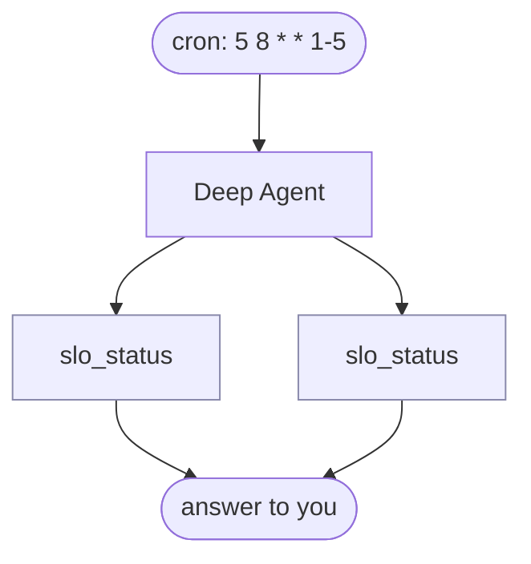

# 012. SLO and error budget status

**When:** 08:05 (morning)  
**Trigger:** `cron: 5 8 * * 1-5`  
**Type:** scheduled check  
**Deep Agents features:** parallel calls

Simple math done reliably every morning, and a freeze suggestion when budget is low.

## What you ask

> How much error budget do my services have left?

## Flow



## Tools

| Tool | What it does | Effect | Control |
|---|---|---|---|
| `slo_status` | SLO and remaining error budget. | read-only | - |

## Run it

```bash
python usecases/swe_day/012_slo_error_budget_status/usecase.py            # offline: scripted model, real Deep Agent
LC_MODEL=anthropic:claude-sonnet-4-6 python usecases/swe_day/012_slo_error_budget_status/usecase.py --live   # a real model makes the decisions
```

## Taking it to production

- Schedule it with `5 8 * * 1-5` (cron, server time; prefix `CRON_TZ=...` for your zone). A LangGraph Platform cron job, a GitHub Actions `schedule:`, or a Kubernetes CronJob all work.
- Swap each `TOOL(..., returns=...)` for a real call (your API, a CLI, or an MCP server through `langchain-mcp-adapters`).
