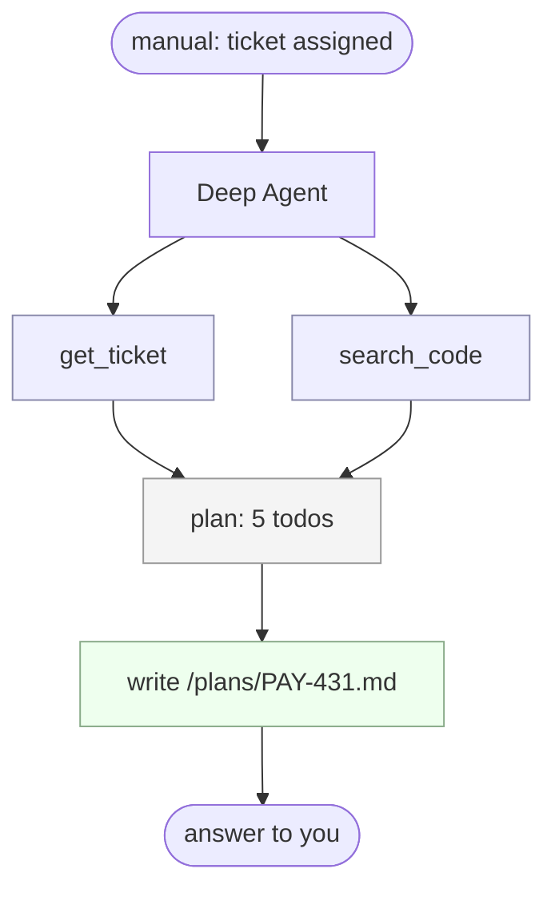

# 013. Jira ticket to implementation plan

**When:** 08:30 (planning)  
**Trigger:** `manual: ticket assigned`  
**Type:** planning  
**Deep Agents features:** todos, filesystem, parallel calls

Reads the ticket and the code it touches, then lays out the steps as a todo list you can follow.

## What you ask

> Turn PAY-431 into an implementation plan.

## Flow



## Tools

| Tool | What it does | Effect | Control |
|---|---|---|---|
| `get_ticket` | Fetch a Jira ticket. | read-only | - |
| `search_code` | Search the codebase. | read-only | - |

## Run it

```bash
python usecases/swe_day/013_ticket_to_implementation_plan/usecase.py            # offline: scripted model, real Deep Agent
LC_MODEL=anthropic:claude-sonnet-4-6 python usecases/swe_day/013_ticket_to_implementation_plan/usecase.py --live   # a real model makes the decisions
```

## Taking it to production

- You start this one yourself: a CLI command, a Slack slash command or an IDE action.
- Swap each `TOOL(..., returns=...)` for a real call (your API, a CLI, or an MCP server through `langchain-mcp-adapters`).
