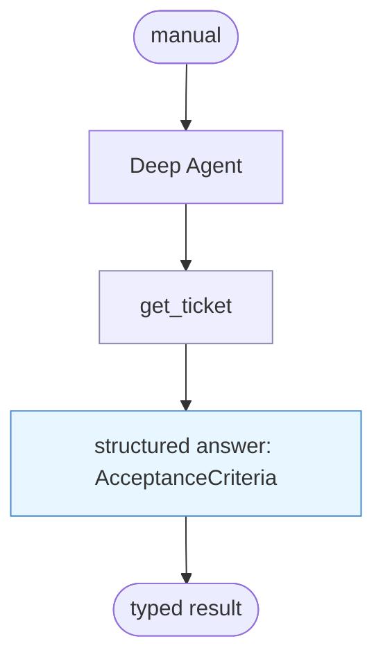

# 014. Acceptance criteria generator

**When:** 08:40 (planning)  
**Trigger:** `manual`  
**Type:** ticket refinement  
**Deep Agents features:** structured output

Turns a vague ticket into testable Given/When/Then criteria in a fixed schema.

## What you ask

> Write acceptance criteria for 'export invoices as CSV'.

## Flow



## Tools

| Tool | What it does | Effect | Control |
|---|---|---|---|
| `get_ticket` | Fetch a ticket. | read-only | - |

## Run it

```bash
python usecases/swe_day/014_acceptance_criteria_generator/usecase.py            # offline: scripted model, real Deep Agent
LC_MODEL=anthropic:claude-sonnet-4-6 python usecases/swe_day/014_acceptance_criteria_generator/usecase.py --live   # a real model makes the decisions
```

## Taking it to production

- You start this one yourself: a CLI command, a Slack slash command or an IDE action.
- The `AcceptanceCriteria` result is a Pydantic object, so you can post it straight to a dashboard or database.
- Swap each `TOOL(..., returns=...)` for a real call (your API, a CLI, or an MCP server through `langchain-mcp-adapters`).
