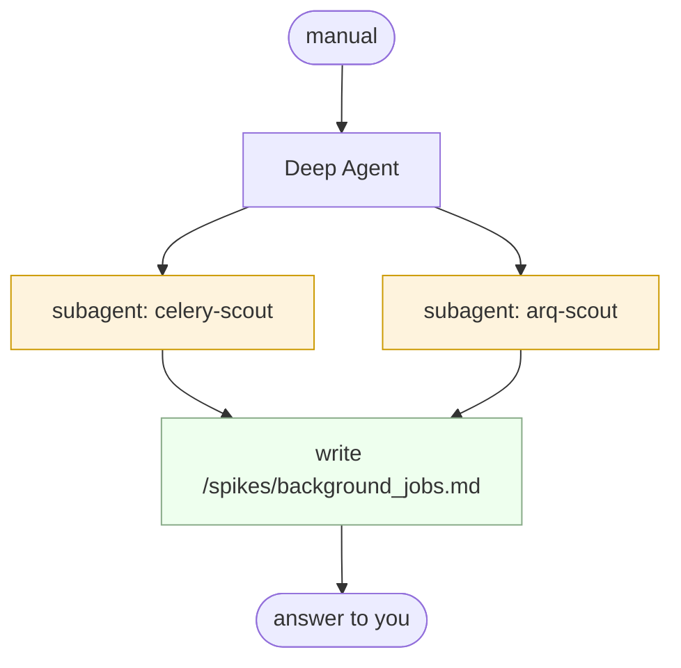

# 016. Library choice spike

**When:** 09:00 (planning)  
**Trigger:** `manual`  
**Type:** research  
**Deep Agents features:** subagents, filesystem, parallel calls

Two researcher subagents investigate in parallel; the main agent writes a short recommendation.

## What you ask

> Should we use Celery or Arq for the new background jobs?

## Flow



## Tools

| Tool | What it does | Effect | Control |
|---|---|---|---|
| `package_stats` | Package health stats. | read-only | - |

## Subagents

- **celery-scout**: Researches Celery. Tools: `package_stats`.
- **arq-scout**: Researches Arq. Tools: `package_stats`.

## Run it

```bash
python usecases/swe_day/016_library_choice_spike/usecase.py            # offline: scripted model, real Deep Agent
LC_MODEL=anthropic:claude-sonnet-4-6 python usecases/swe_day/016_library_choice_spike/usecase.py --live   # a real model makes the decisions
```

## Taking it to production

- You start this one yourself: a CLI command, a Slack slash command or an IDE action.
- Subagents run in their own context window, which keeps the main thread small. Give them a cheaper model if the job is just reading.
- Swap each `TOOL(..., returns=...)` for a real call (your API, a CLI, or an MCP server through `langchain-mcp-adapters`).
