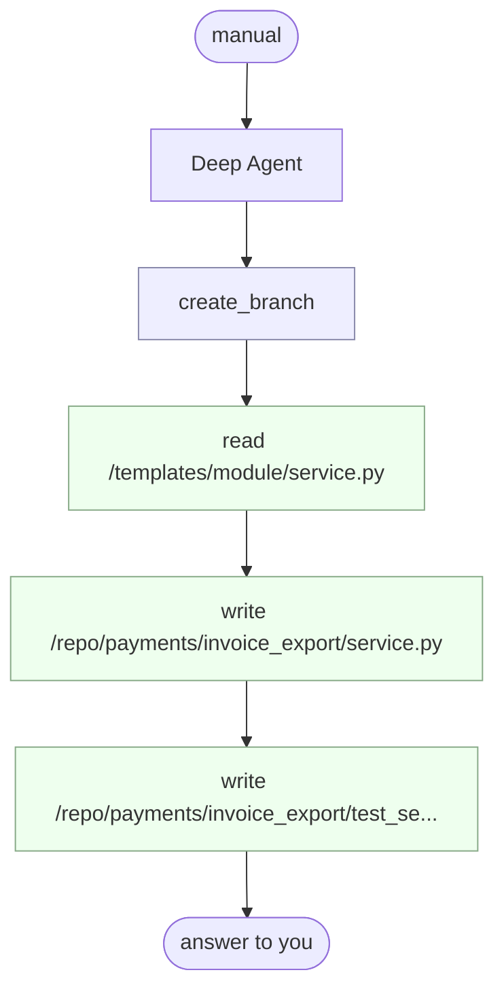

# 017. Scaffold a feature from the service template

**When:** 09:10 (planning)  
**Trigger:** `manual`  
**Type:** scaffolding  
**Deep Agents features:** filesystem

Reads the team's template files and writes the new module skeleton so you start from conventions, not a blank page.

## What you ask

> Scaffold the invoice-export module from our template.

## Flow



## Tools

| Tool | What it does | Effect | Control |
|---|---|---|---|
| `create_branch` | Create a git branch. | changes state | - |

## Run it

```bash
python usecases/swe_day/017_scaffold_feature_branch/usecase.py            # offline: scripted model, real Deep Agent
LC_MODEL=anthropic:claude-sonnet-4-6 python usecases/swe_day/017_scaffold_feature_branch/usecase.py --live   # a real model makes the decisions
```

## Taking it to production

- You start this one yourself: a CLI command, a Slack slash command or an IDE action.
- Swap each `TOOL(..., returns=...)` for a real call (your API, a CLI, or an MCP server through `langchain-mcp-adapters`).
