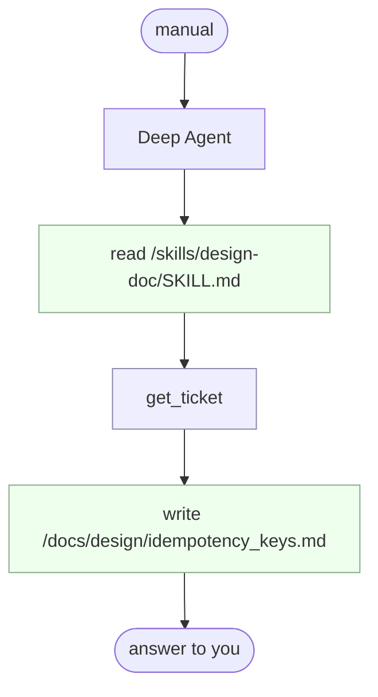

# 018. Design doc first draft

**When:** 09:20 (planning)  
**Trigger:** `manual`  
**Type:** doc drafting  
**Deep Agents features:** skills, filesystem

Follows the team's design-doc skill so every doc has the same sections reviewers expect.

## What you ask

> Draft a design doc for idempotency keys.

## Flow



## Tools

| Tool | What it does | Effect | Control |
|---|---|---|---|
| `get_ticket` | Fetch a ticket. | read-only | - |

## Skills

`/skills/design-doc/SKILL.md`: Use when writing design docs.

1. Context
2. Goals / non-goals
3. Design
4. Alternatives
5. Rollout
6. Risks

## Run it

```bash
python usecases/swe_day/018_design_doc_first_draft/usecase.py            # offline: scripted model, real Deep Agent
LC_MODEL=anthropic:claude-sonnet-4-6 python usecases/swe_day/018_design_doc_first_draft/usecase.py --live   # a real model makes the decisions
```

## Taking it to production

- You start this one yourself: a CLI command, a Slack slash command or an IDE action.
- Swap each `TOOL(..., returns=...)` for a real call (your API, a CLI, or an MCP server through `langchain-mcp-adapters`).
