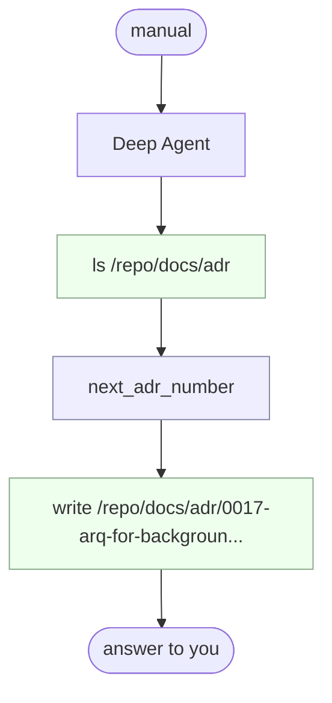

# 019. Architecture decision record

**When:** 09:30 (planning)  
**Trigger:** `manual`  
**Type:** doc drafting  
**Deep Agents features:** filesystem

Captures a decision in the repo's ADR format while the reasoning is fresh.

## What you ask

> Write an ADR for choosing Arq for background jobs.

## Flow



## Tools

| Tool | What it does | Effect | Control |
|---|---|---|---|
| `next_adr_number` | Next ADR number in the repo. | read-only | - |

## Run it

```bash
python usecases/swe_day/019_adr_writer/usecase.py            # offline: scripted model, real Deep Agent
LC_MODEL=anthropic:claude-sonnet-4-6 python usecases/swe_day/019_adr_writer/usecase.py --live   # a real model makes the decisions
```

## Taking it to production

- You start this one yourself: a CLI command, a Slack slash command or an IDE action.
- Swap each `TOOL(..., returns=...)` for a real call (your API, a CLI, or an MCP server through `langchain-mcp-adapters`).
