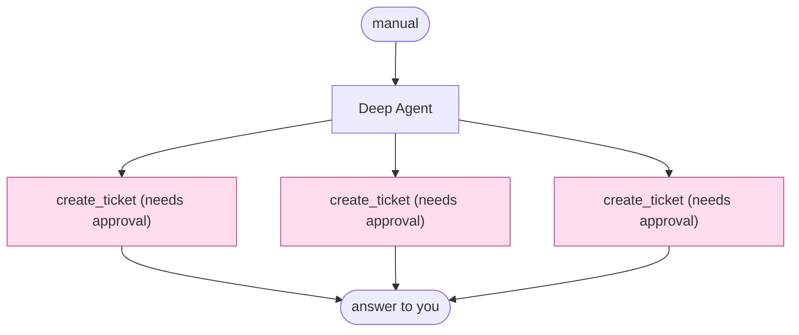

# 020. Break an epic into tickets

**When:** 09:40 (planning)  
**Trigger:** `manual`  
**Type:** ticket creation  
**Deep Agents features:** HITL, parallel calls

Creating tickets is a write; the batch is approved, and one ticket is edited before creation.

## What you ask

> Split the 'Invoice exports' epic into tickets.

## Flow



## Tools

| Tool | What it does | Effect | Control |
|---|---|---|---|
| `create_ticket` | Create a Jira ticket. | changes state | human approval |

## Human decisions in the offline run

- `create_ticket`: call 1: approved; call 2: edited before running (title); call 3: approved

## Run it

```bash
python usecases/swe_day/020_epic_to_tickets/usecase.py            # offline: scripted model, real Deep Agent
LC_MODEL=anthropic:claude-sonnet-4-6 python usecases/swe_day/020_epic_to_tickets/usecase.py --live   # a real model makes the decisions
```

## Taking it to production

- You start this one yourself: a CLI command, a Slack slash command or an IDE action.
- Approvals: the run pauses on an interrupt. In production, send the pending action to Slack or a web UI and resume with `Command(resume={'decisions': [...]})` on the same `thread_id`. You need a persistent checkpointer (Postgres) for this.
- Swap each `TOOL(..., returns=...)` for a real call (your API, a CLI, or an MCP server through `langchain-mcp-adapters`).
