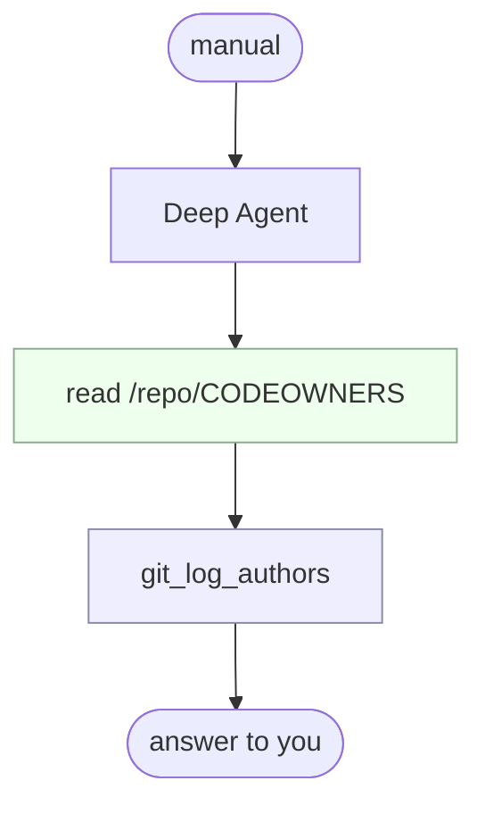

# 022. Find who owns the code you're about to change

**When:** 09:55 (planning)  
**Trigger:** `manual`  
**Type:** lookup  
**Deep Agents features:** filesystem

Combines CODEOWNERS with recent git history so you tag the right people.

## What you ask

> Who should review changes to payments/store.py?

## Flow



## Tools

| Tool | What it does | Effect | Control |
|---|---|---|---|
| `git_log_authors` | Top recent authors of a file. | read-only | - |

## Run it

```bash
python usecases/swe_day/022_find_code_owners/usecase.py            # offline: scripted model, real Deep Agent
LC_MODEL=anthropic:claude-sonnet-4-6 python usecases/swe_day/022_find_code_owners/usecase.py --live   # a real model makes the decisions
```

## Taking it to production

- You start this one yourself: a CLI command, a Slack slash command or an IDE action.
- Swap each `TOOL(..., returns=...)` for a real call (your API, a CLI, or an MCP server through `langchain-mcp-adapters`).
