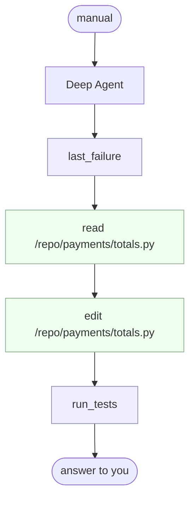

# 024. Fix a failing test

**When:** 10:15 (coding)  
**Trigger:** `manual`  
**Type:** bug fix  
**Deep Agents features:** filesystem

Read failure, read code, make the smallest edit, rerun.

## What you ask

> test_refund_total fails. Fix it.

## Flow



## Tools

| Tool | What it does | Effect | Control |
|---|---|---|---|
| `run_tests` | Run pytest. | read-only | - |
| `last_failure` | Last failure output for a test. | read-only | - |

## Run it

```bash
python usecases/swe_day/024_fix_failing_test/usecase.py            # offline: scripted model, real Deep Agent
LC_MODEL=anthropic:claude-sonnet-4-6 python usecases/swe_day/024_fix_failing_test/usecase.py --live   # a real model makes the decisions
```

## Taking it to production

- You start this one yourself: a CLI command, a Slack slash command or an IDE action.
- Swap each `TOOL(..., returns=...)` for a real call (your API, a CLI, or an MCP server through `langchain-mcp-adapters`).
